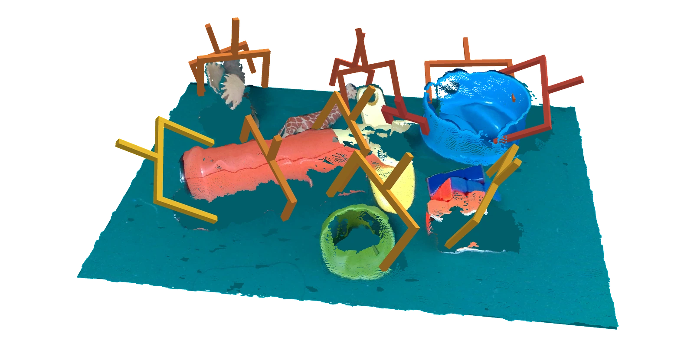
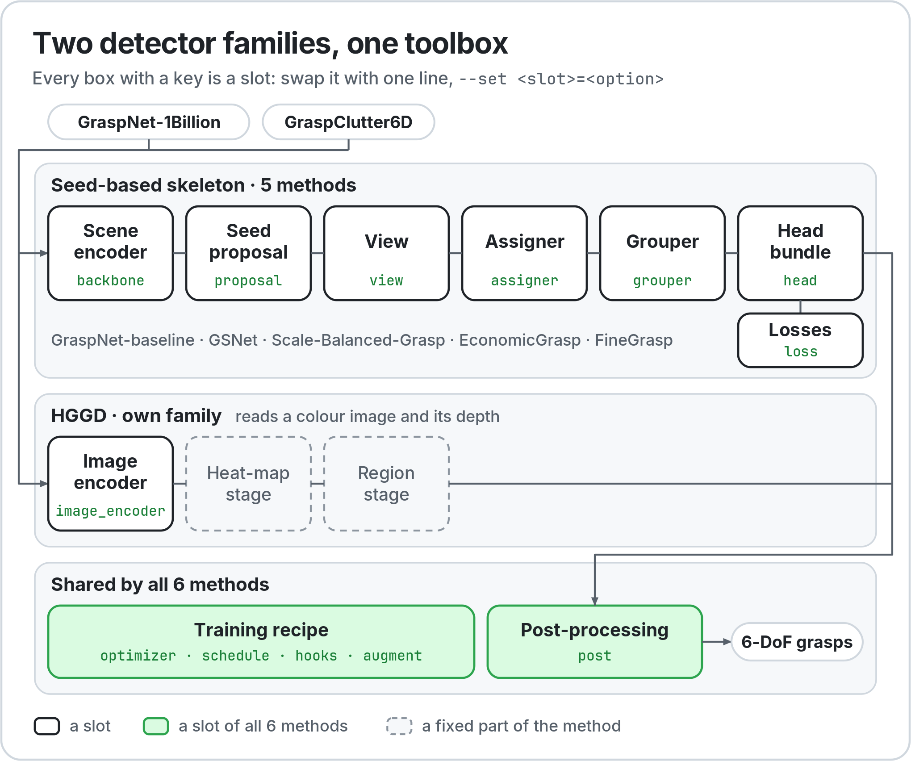

<div align="center">

<picture>
  <source media="(prefers-color-scheme: dark)" srcset="resources/banner-dark.png">
  
</picture>

### 6-DoF grasp detection in clutter, one stage at a time

Six published methods in one PyTorch pipeline, scored by one pinned evaluator.

[](https://github.com/Daeda1used/GraspPanda/actions/workflows/test.yml)
[](https://daeda1used.github.io/GraspPanda)
[](LICENSE)

**English** · [简体中文](README_zh-CN.md) ·
[Documentation](https://daeda1used.github.io/GraspPanda) ·
[Try it](#try-it) ·
[Explorer](https://daeda1used.github.io/GraspPanda/explorer/) ·
[Results](#results)



<sub>EconomicGrasp, from its authors' weights, on a GraspNet-1Billion scene whose objects it never saw in training: its best grasps after the collision filter. Scene CC BY-NC-SA 4.0.</sub>

</div>

## Why GraspPanda

Grasp detection in clutter has strong methods and a great benchmark, but its numbers do not
compare. GSNet reports 65.70 AP on GraspNet-1Billion (RealSense, seen) without the collision
filter and 67.12 with it, and tables quote one against the other. HGGD's README lists
59.36 AP as its paper result and 64.45 as its repository result; two later papers that
re-ran it, [RNGNet](https://arxiv.org/abs/2406.01767) and
[GraRe](https://arxiv.org/abs/2608.00946), report 58.35 and 63.37.

GraspPanda runs every method through one pipeline and one evaluator, which equals
`graspnetAPI` value for value on 1,592 recorded frames
([test](tests/integration/test_eval_parity.py)). Each method matches its reference code
stage by stage, and every number below is backed by a committed record.

## Try it

Grasps from a published model on a scene that ships with the package, no dataset needed.
Install a PyTorch built for CUDA 12.6 or older (sparse convolution has no build for a newer
one):

```bash
pip install torch --index-url https://download.pytorch.org/whl/cu126
git clone https://github.com/Daeda1used/GraspPanda.git && cd GraspPanda
pip install -e ".[spconv-cu126,timm]"
curl -LO \
  https://github.com/iSEE-Laboratory/EconomicGrasp/releases/download/v1/economicgrasp_realsense.tar
python -m tools.convert_checkpoint economicgrasp_realsense.tar economicgrasp_realsense.pth \
    --source-format economicgrasp --camera realsense
grasppanda demo economicgrasp/economicgrasp_sunet14_g1b-realsense_10e \
    --weights economicgrasp_realsense.pth --example --collision-filter
```

`demo` writes the grasps and a picture of them; `grasppanda env` says what is installed
and what to fix. Every method runs the same way, on a dataset frame, a depth image or a
point cloud:
[run a method](https://daeda1used.github.io/GraspPanda/get_started/run_a_method/).

## Swap a stage

<picture>
  <source media="(prefers-color-scheme: dark)" srcset="resources/showcase-dark.svg">
  
</picture>

Every stage of a detector is a slot. `compose` swaps one with a line, checks the contracts
between stages, adds an adapter where one is needed, and refuses what cannot work with the
reason and the fix:

```bash
grasppanda compose graspnet_baseline/graspnet-baseline_pointnet2_g1b-realsense_18e \
    --set backbone=ptv3 -o baseline_ptv3.yaml
grasppanda compose hggd/hggd_r34w8_g1b-realsense_15e \
    --set image_encoder=dinov2-small-reg-depth-stem -o hggd_dinov2.yaml
grasppanda probe baseline_ptv3.yaml   # trains it briefly
```

Without the dataset, a probe runs a synthetic check instead. PTv3 runs under 5/5
seed-based methods; under 4/5 it trains like shipped (worse under
FineGrasp). The DINOv2 encoder runs under HGGD and trains on a par with HGGD's own. A probe
says a swap trains, not how well: fully trained, PTv3 ends 3.8 to 10.4 AP lower
([trained swaps](https://daeda1used.github.io/GraspPanda/advanced_guides/trained_swaps/)).

| Slots | Applies to |
|---|---|
| post-processing, training recipe | All 6 methods |
| scene encoder, seed proposal, view, assigner, grouper, head bundle, loss | Seed-based · 5 methods |
| image encoder | HGGD only |

<details>
<summary>Every slot, and how a detector is put together</summary>

<br>

<picture>
  <source media="(prefers-color-scheme: dark)" srcset="resources/pipeline-dark.png">
  
</picture>

| Slot | `--set` key | What goes in |
|---|---|---|
| [Image encoder](https://daeda1used.github.io/GraspPanda/slots/image_encoders/) | `image_encoder` | HGGD's own encoder and bridges to timm, transformers and torchvision |
| [Scene encoder](https://daeda1used.github.io/GraspPanda/slots/scene_encoders/) | `backbone` | point-based, sparse-voxel and transformer encoders, with released weights where they fit |
| [Seed proposal](https://daeda1used.github.io/GraspPanda/slots/proposal/) | `proposal` | scored or plain seeds, with their samplers |
| [View](https://daeda1used.github.io/GraspPanda/slots/view/) | `view` | view lattices of any size, regressed directions, full rotations |
| [Assigner](https://daeda1used.github.io/GraspPanda/slots/head_loss/) | `assigner` | how labels are matched to the predicted grasps |
| [Grouper](https://daeda1used.github.io/GraspPanda/slots/grouper/) | `grouper` | crops among the seeds or of the scene: shapes, encoders, poolings |
| [Head bundle](https://daeda1used.github.io/GraspPanda/slots/head_loss/) | `head` | the heads of the ported methods and a decoupled grid head |
| [Loss](https://daeda1used.github.io/GraspPanda/slots/losses/) | `<stage>.<term>_loss`, e.g. `head.score_loss` | focal, quality, robust and set losses, set per loss term |
| [Post-processing](https://daeda1used.github.io/GraspPanda/slots/post/) | `post` | collision, table and workspace filters, NMS, selection |
| [Training recipe](https://daeda1used.github.io/GraspPanda/slots/recipe/) | `optimizer`, `schedule`, `hooks`, `augment`, `recipe` | optimizers, schedules, hooks, augmentation; presets that tune the scene encoder apply to the seed-based methods only |

Where each option runs, under which method and why not elsewhere: the
[explorer](https://daeda1used.github.io/GraspPanda/explorer/) and the
[evidence pages](https://daeda1used.github.io/GraspPanda/evidence/).

</details>

## Results

AP on GraspNet-1Billion (RealSense) as seen / similar / novel: what each method reports,
and the method trained here from scratch with the recipe of its config.

| Method | Venue | Collision filter | Reported | Trained here |
|---|---|:---:|---|---|
| [GraspNet-baseline](https://daeda1used.github.io/GraspPanda/methods/graspnet_baseline/) | CVPR 2020 | on | 47.47 / 42.27 / 16.61 | 46.81 / 41.90 / 16.74 |
| [GSNet](https://daeda1used.github.io/GraspPanda/methods/gsnet/) | ICCV 2021 | off | 65.70 / 53.75 / 23.98 | 68.83 / 60.35 / 25.20 |
| [Scale-Balanced-Grasp](https://daeda1used.github.io/GraspPanda/methods/scale_balanced_grasp/) | CoRL 2022 | off | 58.95 / 52.97 / 22.63 | 57.23 / 51.13 / 21.98 |
| [EconomicGrasp](https://daeda1used.github.io/GraspPanda/methods/economicgrasp/) | ECCV 2024 | off | 68.21 / 61.19 / 25.48 | 69.34 / 61.41 / 26.21 |
| [FineGrasp](https://daeda1used.github.io/GraspPanda/methods/finegrasp/) | arXiv 2025 | off | 71.67 / 62.83 / 27.40 | 69.77 / 59.72 / 25.77 |
| [HGGD](https://daeda1used.github.io/GraspPanda/methods/hggd/) | RA-L 2023 | not stated · on | 64.45 / 53.59 / 24.59 | 63.61 / 54.31 / 24.95 |

GraspNet-baseline is within 1 AP of the reported number on every split. Scale-Balanced-Grasp,
EconomicGrasp and HGGD land on their authors' checkpoints; GSNet ends above its paper and
FineGrasp below, and neither gap is explained. The
[model zoo](https://daeda1used.github.io/GraspPanda/model_zoo/) has every row, both filter
settings and the authors' weights scored here. The weights trained here are not published
yet; every method runs from its authors' weights.

<details>
<summary>Notes on these numbers</summary>

<br>

- **GraspNet-baseline** was trained here once and is within the gate on every split
  against its repository's numbers, the row that states the collision filter.
- **GSNet** was trained here three times with the same seed; the trainings differ by
  about one AP at most. It is above the paper by more than the gate allows, and why is not
  known. What is known: the port equals the reference implementation stage by stage, a
  model trained with the reference code (on a modified label set) is also above the paper,
  and the authors' original code is not public
  ([details](https://daeda1used.github.io/GraspPanda/model_zoo/#graspnet-1billion)).
- **Scale-Balanced-Grasp** was trained here once and scores what its authors' checkpoint
  scores here, within about half an AP. Both are below the paper by more than the gate
  allows on the seen and similar splits, so the gap is not one of training.
- **EconomicGrasp** was trained here three times with the same seed. The trainings lie up
  to 1.75 AP apart, and the score of its authors' checkpoint here lies among them on every
  split. The checkpoint is above the published table on seen by slightly more than the
  gate allows; why the table is lower is not known.
- **FineGrasp** was trained here once and is below the paper by more than the gate allows,
  which is not explained either. The authors' weights give the paper's numbers through the
  same test, so the gap comes from training; their normal images and graspness labels are
  not published and are generated here.
- **HGGD** publishes two sets of numbers, its paper's and its repository's (the row above),
  and states the collision filter for neither; its released test
  script filters collisions before it saves the grasps. Trained here on
  [denser labels](projects/hggd_labels/) than its released converter writes, it reaches its
  authors' RealSense checkpoint; on the converter's it is far below.
- **The authors' released weights** of every method but GSNet were scored on the whole
  test splits here, with and without the collision filter: the `author-ckpt` rows of the
  model zoo. They are not reproductions.
- **Admission rule:** config, weights with sha256, training log and a result record of the
  pinned evaluator, within 1 AP on each split or with the gap documented.

</details>

## Learn more

- [Run a method](https://daeda1used.github.io/GraspPanda/get_started/run_a_method/): every
  method from its released weights, with its licence and a recorded run.
- [Swap a component](https://daeda1used.github.io/GraspPanda/get_started/swap/): compose,
  probe and train a combination.
- [The explorer](https://daeda1used.github.io/GraspPanda/explorer/): every option under
  every method, what was measured, and why a combination is refused.
- [Design](https://daeda1used.github.io/GraspPanda/design/ARCHITECTURE/) ·
  [Contributing](CONTRIBUTING.md) · [Changelog](CHANGELOG.md)

**Status:** alpha. Next: the weights trained here, and a release on PyPI. Releases up to
v0.56 are an earlier, unrelated code base, kept under their tags and on the `legacy`
branch.

## Citation

<details>
<summary>BibTeX</summary>

```bibtex
@software{grasppanda,
  title  = {GraspPanda: A Toolbox for 6-DoF Grasp Detection in Clutter},
  author = {{GraspPanda Contributors}},
  year   = {2026},
  url    = {https://github.com/Daeda1used/GraspPanda}
}
```

Please also cite the methods and datasets you use; each method page lists its reference.

</details>

## Acknowledgements

GraspPanda borrows ideas from [PaddleSeg](https://github.com/PaddlePaddle/PaddleSeg),
[MMEngine](https://github.com/open-mmlab/mmengine),
[Detectron2](https://github.com/facebookresearch/detectron2) and
[Pointcept](https://github.com/Pointcept/Pointcept), and builds on the
[GraspNet-1Billion](https://graspnet.net) and
[GraspClutter6D](https://huggingface.co/datasets/GraspClutter6D/GraspClutter6D) benchmarks and
the authors of the methods it ports. Methods and evaluators are written from the papers and
from the behaviour of the reference code; no file of those repositories is copied. Code
adapted from MIT, BSD or Apache-2.0 projects is listed in
[THIRD_PARTY_NOTICES.md](THIRD_PARTY_NOTICES.md); [NOTICE](NOTICE) says how the datasets,
upstream code and released weights are licensed.

🐼 *The panda is the animal, not the robot arm: GraspPanda is not tied to any robot.*

## License

[Apache License 2.0](LICENSE). Datasets, upstream repositories and released weights keep
their own licences, stated per method.
