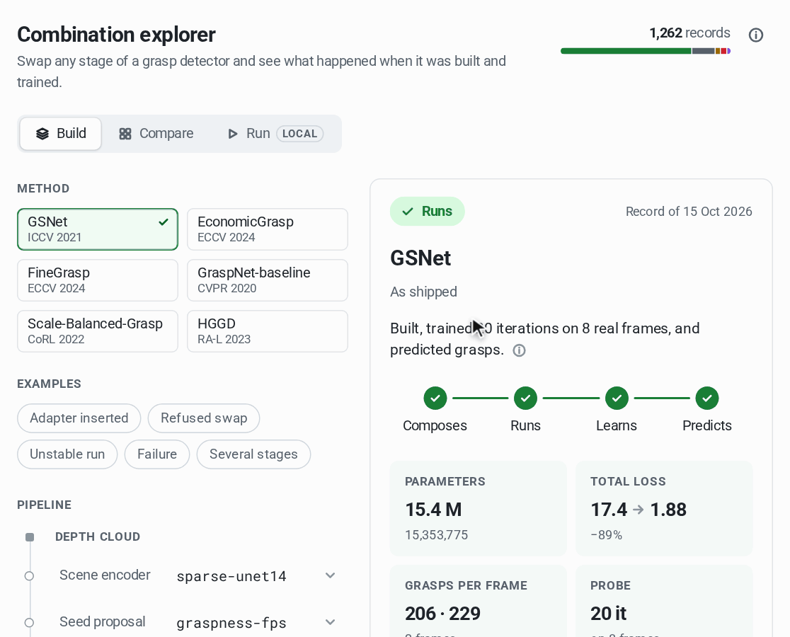
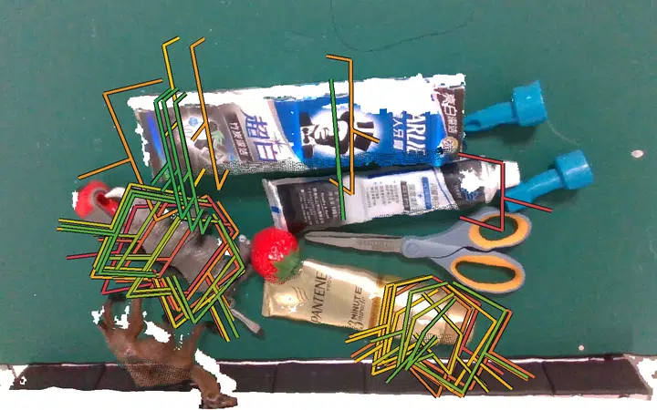

<div align="center">

<picture>
  <source media="(prefers-color-scheme: dark)" srcset="resources/banner-dark.png">
  
</picture>

[English](README.md) | **简体中文**

[](https://github.com/Daeda1used/GraspPanda/actions/workflows/test.yml)
[](https://daeda1used.github.io/GraspPanda)
[](#-安装与快速开始)
[](pyproject.toml)
[](https://pytorch.org)
[](LICENSE)
[](#-路线图)

[文档](https://daeda1used.github.io/GraspPanda) ·
[快速开始](#-安装与快速开始) ·
[Model zoo](#-model-zoo) ·
[路线图](#-路线图) ·
[设计文档](docs/design/ARCHITECTURE.md) ·
[参与贡献](CONTRIBUTING.md)

<a href="https://daeda1used.github.io/GraspPanda/explorer/"><picture>
  <source media="(prefers-color-scheme: dark)" srcset="resources/explorer-dark.webp">
  
</picture></a>

**抓取检测器的任何一个阶段都能换，换完立刻知道能不能用。** 每个结论都来自实测记录。<br>
[**打开组合浏览器 →**](https://daeda1used.github.io/GraspPanda/explorer/) · 也可以在本地运行：`grasppanda explore`

</div>

**GraspPanda 之于杂乱场景 6-DoF 抓取检测，就像 MMDetection 之于目标检测：**
在同一套代码里，流程的每个阶段都能在 YAML 里替换，已发表的方法逐阶段对照参考实现移植并验证，
所有数字都出自同一套固定的评测。

🐼 *Panda 指的是熊猫这种动物，不是那款机械臂。GraspPanda 不绑定任何机器人。*

> [!NOTE]
> **Alpha 阶段。** 现在已经可用：配置系统、两个基准的数据读取、两个评测器（与官方工具逐阶段一致）、
> 拆成可替换组件的六个方法（GSNet、EconomicGrasp、FineGrasp、HGGD、GraspNet-baseline、Scale-Balanced-Grasp，
> 用转换后的权重各自与参考实现逐阶段一致）、流程中每个槽位的可选组件（见[槽位总览](docs/slots/index.md)），
> 以及 `train` / `test` / `infer` / `demo` / `analyze` / `sweep` / `compose` / `probe` / `explore` 命令。
> 第一个在本工具箱内从零训练的模型 GSNet 已在两个基准的完整测试集上评测完毕（成绩高于论文；权重暂未发布），
> 所以 model zoo 里仍然没有可下载的权重。方法必须先在本工具箱内训练*并*评测，才能进入 model zoo。
> 凡不属于已移植方法的选项，一律不声明精度。

<div align="center">
<picture>
  <source media="(prefers-color-scheme: dark)" srcset="resources/showcase-dark.svg">
  
</picture>

*真实输出，只删行，不编造。一个组合就是一条命令；错误的组合在构建之前就被拒绝并给出改法；probe 告诉你它能不能训练。probe 不代表任何精度。*

**[在浏览器里动手试组合 →](https://daeda1used.github.io/GraspPanda/explorer/)** 每个槽位、每个选项：960 条已记录组合的实测结论（其中 740 条由各自的 probe 在真实帧上实际试跑），任意两处替换还附带真实 `compose` 的回答。也可以在本地运行 `grasppanda explore`，由你自己的安装实时检查任意组合。



*GSNet 在 GraspNet-1Billion 测试帧上的预测（碰撞过滤后得分最高的 40 个），由 GraspPanda 的实现加载参考代码训练的权重算出。场景图像来自 GraspNet-1Billion，CC BY-NC-SA 4.0。*
</div>

## 📰 News

- **2026-10** — 重建后的第一个公开版本。六个方法拆成可互换组件，各自与参考实现逐阶段一致；十一个场景编码器；`grasppanda components`、`demo`、`analyze`；GraspClutter6D 端到端可用。v0.56 及以前的版本是更早的、无关的代码库，仍可通过原有 tag 和 `legacy` 分支获取。
- **2026-10** — `grasppanda compose` 用一个方法配置加一个预设拼出组合，`grasppanda probe` 在真实帧上训练几步试跑；另有一页自动生成的实测结果，覆盖全部已记录的组合（当时为 208 个）（哪个组件能在哪个方法下工作，哪些被契约规则拒绝）。
- **2026-10** — [每个槽位都有了可选项](docs/slots/index.md)，共 248 个，来自已发表的代码和模型库（图像与场景编码器、seed 提议、朝向、局部分组、head 与损失、后处理、训练配方）。每个选项在所属槽位的页面上有一行说明和一条命令，并有逐方法的实测结论；它们都还没有完整训练和评测过，所以都不带精度数字。
- **2026-10** — [组合浏览器](https://daeda1used.github.io/GraspPanda/explorer/)：选一个方法，换一个槽位，就能看到实测结论、对应命令和被拒绝的原因；没有记录的两处替换给出 `compose` 的存档回答；`grasppanda explore` 在本地打开同一页面，并用真实的 `compose` 检查任意选择。
- **2026-10** — 更多“通过检查、第一步训练才报错”的组合现在会在配置检查时被拒绝并给出改法：head 或朝向阶段的网格与标签不一致、seed 数与编码器输出点数不一致、带图像的数据上移动点云的增强、缺少完整点云的碰撞过滤、检测器尚未支持的混合精度。真实帧上的 probe 现在会报告没有收到梯度的模块。
- **2026-10** — 又有两类错误组合在配置检查时就被拒绝，而不是到后面才报错：数据配方不提供某个阶段所需标签的组合，以及编码器输出宽度与分组器不匹配的组合（此时 `compose` 会调整编码器宽度或换上带投影的分组器，并明确说明）。

## 🤔 为什么做 GraspPanda

杂乱场景抓取检测已经有很强的方法和很好的基准，但要公平地比较它们，比想象中难。

- **加和不加碰撞过滤的数字被混在一起比。** GSNet 在 GraspNet-1Billion（RealSense，seen）上不加过滤是 65.70 AP，加了是 67.12。拿其中一个去比另一个，差距就超过了不少论文声称的提升。
- **同一个方法，数字不一样。** HGGD 自己的 README 把 59.36 AP（RealSense，seen）列为论文结果，把 64.45 列为仓库结果；后来两篇复测它的论文给出的是 58.35 和 63.37。
- **每个方法各住各的仓库**，各有各的数据流程、标签文件、编译算子，往往还带一份自己的评测器。

GraspPanda 的回答是：一条流程、一个评测器，外加一条规则——**只宣传验证过的能力**。

## ✨ 特性

| | |
|---|---|
| 🎯 **认证过的复现** ⏳ | 方法必须在本工具箱内训练并评测，AP 与发表数字相差不超过 1，或者把差距解释清楚，才能进入 model zoo。每个数字都标明出处：`reported`、`author-ckpt` 或 `reproduced`。 |
| 🧩 **可替换的组件** | backbone、种子提议、接近方向、局部 grouping、head bundle、loss、后处理都是配置里的槽位。一次消融就是一个基础配置加一行覆盖。 |
| 🛡️ **类型化契约，严格配置** | 未知的键、错误的类型、不兼容的替换都会报错并给出修改建议，而且发生在构建任何东西之前。不会悄悄插值、投影或压缩维度。 |
| 📏 **一套固定的评测** | 对 GraspNet-1Billion 和 GraspClutter6D 官方协议做 clean-room 重写，与官方工具逐阶段一致（1,592 个记录帧，零差异），速度约 40 倍，内存约九分之一。加和不加碰撞过滤的结果总是同时报告。 |
| 🔍 **诚实的输入** | `predict()` 永远拿不到真值。由真值派生的输入（比如多数流程在测试时使用的真值工作区裁剪）必须写在配置里，并标注在结果上。 |
| 📦 **精简的核心** | 只依赖 `torch`、`numpy`、`pyyaml`。稀疏卷积等重型依赖是可选项；算子都有纯 PyTorch 的参考实现。 |
| 🧾 **可复现的运行** | 每次运行都会保存展开后的配置、命令行覆盖、代码、git 状态和环境信息。 |

⏳ 表示仍在进行中的部分（还没有方法通过准入门槛）；其余现在就能用。

### 一个配置就是一次完整实验

```yaml
_base_:                                     # 随包提供的基础配置，在任何目录下都能找到
  - _base_/default_runtime.yaml
  - _base_/schedules/gsnet_10e.yaml

custom_imports: [../toy_components.py]      # 仓库外的代码，不需要 fork

model:
  type: ToyDetector
  backbone: {type: ToyBackbone, out_channels: 64}
  grouper:  {type: ToyGrouper, radius: 0.05, nsample: 16}
  head:     {type: ToyHead, num_angle: 12, num_depth: 4}
```

```bash
# 替换组件：旧类型的参数会被丢弃，而不是悄悄合并进来
grasppanda print-config <config> --opts optimizer.type=SGD --check

# 查看一次运行实际用到的全部设置，包括默认值
grasppanda print-config <config> --defaults
```

### 一条流程，类型化的契约

<div align="center">

</div>

### 每个槽位都有可选项

“选项”就是写在 `--set <槽位>=` 后面的名字：一个组件，加上一套适合桌面深度点云的设置。每个槽位的页面先讲这个阶段要做什么、
输入输出是什么，然后每个选项一行说明、一条命令。[槽位总览](docs/slots/index.md)根据实测记录把每个选项归为
universal（五个方法通用）、most、some 或 specific（只适用于一个方法），并按“能组合、能跑、能学、能预测”四级分别给出。文档目前为英文。

| 槽位 | 选项数 | 内容 |
|---|---|---|
| [图像编码器](docs/slots/image_encoders.md) | 38 | HGGD 自带的编码器，以及通往 timm、transformers、torchvision 的桥接；seed-based 方法可通过 point painting 使用 |
| [场景编码器](docs/slots/scene_encoders.md) | 47 | 基于点的网络、稀疏体素网络、Transformer 和预训练三维编码器；有公开权重且能对上的都可以加载 |
| [Seed 提议](docs/slots/proposal.md) | 24 | 打分或不打分的 seed 选取，配十一种采样器 |
| [朝向（view）](docs/slots/view.md) | 21 | 任意大小的视角格点、直接回归方向、回归完整旋转 |
| [局部分组（grouper）](docs/slots/grouper.md) | 32 | 在 seed 之间或在整个场景上取局部区域：形状、编码方式、池化、RoI 池化、图卷积层 |
| [Head bundle 与标签分配](docs/slots/head_loss.md) | 10 + 4 | 已移植方法的 head、一个解耦的网格 head，以及与之配套的标签分配器 |
| [损失](docs/slots/head_loss.md) | 20 | focal、质量、鲁棒、集合类损失，难例挖掘、类别平衡、不确定性加权，按损失项替换 |
| [后处理](docs/slots/post.md) | 15 | 碰撞、桌面、工作空间、夹爪限位等过滤，NMS，筛选，坐标系变换 |
| [训练配方](docs/slots/recipe.md) | 37 | 优化器、学习率调度、hook、数据增强（其中混合精度目前对所有自带检测器都会被配置检查拒绝） |

## 🗺️ 总览

✅ 已可用 · 🚧 进行中 · 📅 计划中

| 模块 | 状态 | 内容 |
|---|---|---|
| **核心** | ✅ | 支持继承和三层严格校验的 YAML 配置 · 自动延迟导入的注册表 · 构建时注入 · 运行快照 |
| **数据契约** | ✅ | `Observation` / `Supervision` · `PointSet` / `PointFeatures` · `SeedSet` · `ApproachSet` · `GroupFeatures` · `GraspGroup` |
| **算子** | ✅ | 最远点采样 · ball / cylinder query · kNN · 插值 · grasp NMS · 体素化 · 空间填充曲线 · view 模板（纯 PyTorch 参考实现，可在 CPU 上测试）· 四个热点算子有可选的 CPU / CUDA 编译内核，在实际运行的设备上与参考实现自检一致（[详情](docs/advanced_guides/operators.md)） |
| **命令行** | ✅ `train`、`test`、`infer`、`demo`、`analyze`、`components`、`compose`、`probe`、`explore`、`sweep`、`prepare`、`print-config`、`env` · 📅 `profile` | |
| **数据集** | ✅ GraspNet-1Billion 和 GraspClutter6D 的读取、split 清单、带内容哈希的标签资产（在记录帧上与参考预处理一致） | |
| **评测** | ✅ GraspNet-1Billion 和 GraspClutter6D 评测器，带 coverage 和出处的结果记录 | |
| **方法** | ✅ GSNet、EconomicGrasp、FineGrasp、GraspNet-baseline、Scale-Balanced-Grasp（共用一个 seed-based 骨架）和 HGGD（自成一族）：用转换后的权重各自与参考实现逐阶段一致 · 🚧 全量测试集评测和从零复现 · 📅 Contact-GraspNet | |
| **场景编码器** | ✅ 有官方权重、已与官方代码对比过输出的：稀疏 U-Net（spconv）、SpUNet（MinkUNet-34C 结构）、OA-CNNs、PointNet++（两种形式）、PointNeXt、PTv3、带 Concerto 和 Utonia 权重的 PTv3、LitePT（[详情](docs/model_zoo_backbones.md)）· ✅ 可用但未做对比的：[槽位页面](docs/slots/scene_encoders.md)里的其余编码器 · 编码器与方法的每一种组合，要么能训练，要么在配置阶段被拒绝并给出改法（[互换矩阵](docs/advanced_guides/swapping.md)） | |

## 🏆 Model zoo

这张表列的是**目标**：原作者在 GraspNet-1Billion 上报告的数字（RealSense，seen / similar / novel
的 AP）；最后一列是在本工具箱内训练出的模型的成绩，目前只有 GSNet。

GSNet 按其配置中的训练方案从零训练（只训练了一次，一个随机种子）。它比论文数字高出 1 AP 以上，
超出了准入规则允许的范围，所以没有通过认证；差距从何而来目前还不知道：本实现与公开的参考实现逐阶段一致，
用参考代码在修改过的标签集上另行训练的模型同样高于论文，而论文数字出自作者没有公开的原始代码
（[详情](configs/gsnet/README.md#results-on-graspnet-1billion)）。它的权重暂未发布。
除此之外，测过的都是作者发布的权重在本工具箱里的得分：五个方法跑完了 GraspNet-1Billion 的整个测试集，
其中四个还跑了 GraspClutter6D，开、关碰撞过滤各一行，旁边列出作者报告的数字。这些 `author-ckpt`
数字和 GSNet 的数字一起列在 [docs/model_zoo.md](docs/model_zoo.md) 里，每个数字都有提交在仓库里的结果记录可查；
`author-ckpt` 是作者权重的评测结果，不是复现。

| 方法 | 发表 | 碰撞过滤 | 作者报告的 AP（seen / similar / novel） | 本工具箱复现 |
|---|---|:---:|---|:---:|
| GraspNet-baseline | CVPR 2020 | 开 | 47.47 / 42.27 / 16.61（其 README 的 "In repo" 行） | — |
| GSNet | ICCV 2021 | 关 | 65.70 / 53.75 / 23.98 | 68.83 / 60.35 / 25.20 |
| GSNet | ICCV 2021 | 开 | 67.12 / 54.81 / 24.31 | 71.23 / 62.29 / 26.42 |
| EconomicGrasp | ECCV 2024 | 关 | 68.21 / 61.19 / 25.48 | — |
| HGGD | RA-L 2023 | 见注 | 59.36 / 51.20 / 22.17（其 README 的 "In paper" 行）· 64.45 / 53.59 / 24.59（"In repo" 行，arXiv 版论文同此） | — |
| Scale-Balanced-Grasp | CoRL 2022 | 关 | 58.95 / 52.97 / 22.63 | — |
| Scale-Balanced-Grasp | CoRL 2022 | 开 | 63.83 / 58.46 / 24.63 | — |
| FineGrasp | arXiv 2025 | 关 | 71.67 / 62.83 / 27.40 | — |
| FineGrasp | arXiv 2025 | 开 | 73.71 / 64.56 / 28.14 | — |

注：HGGD 公开了两组数字，且没有说明是否做碰撞过滤；它发布的测试脚本在保存结果前会过滤碰撞。这两组数字之间差在哪些设置上，正是这个工具箱要查清楚的事情之一。

准入规则：配置 + 权重（sha256）+ 训练日志 + 固定评测器产出的结果记录，
并且每个 split 上 `|复现 − 报告| ≤ 1 AP`，否则要写明差距和原因。

## 🚀 安装与快速开始

先按你的 CUDA 版本装好 PyTorch，然后：

```bash
git clone https://github.com/Daeda1used/GraspPanda.git
cd GraspPanda
pip install -e .
```

三条命令看到框架在工作，不需要任何数据集：

```bash
grasppanda env                                                              # 环境报告
grasppanda train projects/example_project/configs/toy_train.yaml            # 在 CPU 上几秒钟训练一个玩具检测器
grasppanda print-config projects/example_project/configs/toy_detector.yaml \
    --opts model.grouper.type=ToyDepthGrouper                               # 被拒绝，并说明原因
```

### 五分钟得到第一批抓取

第一张图不需要任何数据集。Model zoo 目前还没有可下载的权重，原作者的权重各有其许可证，因此本工具不会替你下载任何抓取权重。（唯一的例外：`pretrained: true` 的图像编码器预设会让 `timm`、`transformers` 或 `torchvision` 在首次使用时下载预训练权重，并打印一行说明其许可证；见 [image encoders](docs/slots/image_encoders.md)。）

**1. 检查安装**（无需下载，CPU，几秒钟）：现场训练一个玩具检测器。

```bash
grasppanda train projects/example_project/configs/toy_train.yaml --opts runtime.run_id=toy
grasppanda demo  projects/example_project/configs/toy_train.yaml \
    --weights work_dirs/toy_train/toy/checkpoints/best.pth --example
```

`--example` 是随软件包提供的合成桌面场景。玩具模型的抓取没有实际意义，这条命令只说明整个流程可以跑通。

**2. 真实方法。** 自行下载原作者的权重，转换一次，然后运行。每个方法都有一页逐步说明：权重文件、许可证、转换命令、演示、Python 与浏览器中的同一流程，以及在部分基准上的第一个 AP，每一步都附有实测时的输出：[GSNet](docs/methods/gsnet.md) · [EconomicGrasp](docs/methods/economicgrasp.md) · [FineGrasp](docs/methods/finegrasp.md) · [GraspNet-baseline](docs/methods/graspnet_baseline.md) · [Scale-Balanced-Grasp](docs/methods/scale_balanced_grasp.md) · [HGGD](docs/methods/hggd.md)。以 GraspNet-baseline 为例：

```bash
python -m tools.convert_checkpoint checkpoint-rs.tar baseline_realsense.pth \
    --source-format graspnet-baseline --camera realsense
grasppanda demo graspnet_baseline/graspnet-baseline_pointnet2_g1b-realsense_18e \
    --weights baseline_realsense.pth --example --collision-filter
```

命令会打印得分最高的抓取，并写出 `grasps.npy`（GraspNet 17 列格式，相机坐标系，单位米）、`grasps.png` 和 `grasps.gif`。

**3. 你自己的相机。** 点云方法只需要深度图和相机内参；HGGD 还需要与深度图配准的彩色图：

```bash
grasppanda demo <config> --weights <file> --depth depth.png --intrinsics fx,fy,cx,cy \
    --workspace -0.25 -0.2 0.35 0.25 0.2 0.8
```

这些模型在 GraspNet-1Billion 上训练（RealSense D435 与 Azure Kinect，桌面场景），在其他相机上的效果尚未测量。同一套流程在 Python 里是 `GraspInferencer`；`grasppanda analyze` 说明一次评测的 AP 来自哪里：见[推理与可视化](docs/user_guides/inference.md)。

### 试一个组合

```bash
grasppanda compose --list grouper                            # 一个槽位有哪些选项，每个一行
grasppanda compose gsnet/gsnet_sunet14_g1b-realsense_10e --set backbone=ptv3 -o gsnet_ptv3.yaml
grasppanda probe gsnet_ptv3.yaml                             # 在真实帧上训练 20 步，再预测
grasppanda train gsnet_ptv3.yaml

# 一次换两个槽位，用的是 2026-10 新增的选项（已有记录：runs）
grasppanda compose gsnet/gsnet_sunet14_g1b-realsense_10e --set backbone=point-transformer-v2 \
    --set grouper=cylinder-vector-attention -o gsnet_ptv2_attention.yaml
grasppanda explore                                           # 在浏览器里做同样的事，由 compose 检查
```

`compose` 由方法配置和预设写出一份检查过的配置；阶段契约需要适配器时会自动插入并说明；被契约拒绝的组合会给出冲突原因和改法；组合出的配置还可以作为基础继续组合。`probe` 最后给出一个结论（`runs`、`runs-empty`、`runs-unstable`、`fails`、`refused`），并指出哪些部分没有学到东西：不下降的损失项、收不到梯度的模块。哪个组件能在哪个方法下工作是在真实帧上实测的，不是推断的：见[槽位总览](docs/slots/index.md)、[试一个组合](docs/user_guides/combinations.md)和[实测组合表](docs/advanced_guides/measured_combinations.md)。组合在完成训练和评测之前，不对其精度作任何声明。

### 基准数据集

磁盘上有 GraspNet-1Billion 时（`export GRASPPANDA_GRASPNET1B_ROOT=...`，
并安装稀疏卷积后端：`pip install -e ".[spconv-cu118]"`）：

```bash
grasppanda prepare graspnet1b --check                        # 检查数据集目录
grasppanda prepare graspnet1b --labels                       # 内存映射的抓取标签
grasppanda prepare graspnet1b --graspness --camera realsense # 逐点 graspness 标签
grasppanda train gsnet/gsnet_sunet14_g1b-realsense_10e
grasppanda test  gsnet/gsnet_sunet14_g1b-realsense_10e --weights <checkpoint>
```

在 GraspNet-1Billion 上训练的模型，一条命令就能在 GraspClutter6D 上评测（见[跨数据集评测](docs/user_guides/cross_dataset.md)）：

```bash
grasppanda test gsnet/gsnet_sunet14_g1b-realsense-to-gc6d-d435_10e --weights <checkpoint>
```

`grasppanda components` 列出每个槽位可以放什么。换场景编码器只要一行覆盖；不兼容的替换会被拒绝并说明原因：

```bash
grasppanda print-config gsnet/gsnet_sunet14_g1b-realsense_10e --check \
    --opts "model.backbone={type: PTv3, in_channels: 3, grid_size: 0.005}"
```

从配置构建一个检测器并运行：

```python
import torch
from grasppanda.config import Config
from grasppanda.registry import DETECTORS
from grasppanda.structures import Observation, PointSet, SampleKey

config = Config.load("projects/example_project/configs/toy_detector.yaml")
model = DETECTORS.build(config["model"]).eval()

observation = Observation(
    keys=[SampleKey("demo", 0, "none", 0)],
    points=PointSet.from_dense(torch.rand(1, 2048, 3)),
)
grasps = model.predict(observation)[0]     # GraspGroup：translation、rotation、width、depth、score
array = grasps.to_graspnet_array()         # (64, 17)，GraspNet 的交换格式
```

示例检测器只是一个接线模板：它没有训练过，输出的抓取是随意的。
`pip install grasppanda` 会随第一个正式版本提供。

## 🧭 路线图

- [x] **M0 — 核心。** 配置系统、注册表、数据契约、参考算子、命令行、CI、文档骨架、品牌素材。
- [ ] **M1 — GraspNet-1Billion、评测器、GSNet。** ✅ 评测器与官方 API 逐值一致。✅ GSNet 用转换后的权重与参考实现逐阶段一致。✅ 已从零训练，并在完整测试集上评测（比论文高 1.2 到 7.5 AP）。🚧 差距的原因尚未查明；权重暂未发布。
- [ ] **M2 — EconomicGrasp 和 HGGD。** 一个同族的第二方法，和一个刻意选来检验抽象的异类。✅ 两者用作者权重都与参考实现逐阶段一致。🚧 全量评测和训练。
- [ ] **M3 — Scale-Balanced-Grasp、GraspNet-baseline、FineGrasp。** 第一张受控对比表：相同 backbone、相同预算、相同输入、相同评测器。✅ 三者用作者权重都与参考实现逐阶段一致。📅 对比表。
- [ ] **M4 — GraspClutter6D 和 Contact-GraspNet。** ✅ 数据读取、评测器（在 254 个记录帧上与官方工具一致）、标签资产、五个方法的迁移配置（在 312 帧子集上检查过）。📅 全量迁移结果表、在 GraspClutter6D 上训练、Contact-GraspNet。
- [ ] **M5 — 发布。** PyPI、model zoo、文档站。

## 📚 教程

- [配置指南](docs/user_guides/config.md)：继承、合并规则、命令行覆盖、校验。
- [槽位总览](docs/slots/index.md)：每个阶段做什么、有哪些选项、哪个选项适用于哪个方法。
- [试一个组合](docs/user_guides/combinations.md)：查目录、拼组合、试跑、训练。
- [新增组件](docs/advanced_guides/add_component.md)：不 fork 就能注册 backbone 或 head bundle。
- [数据契约](docs/advanced_guides/data_flow.md)：每个阶段接收什么、返回什么。
- [架构设计](docs/design/ARCHITECTURE.md)：完整设计，以及每个决定背后的依据。

## 📝 引用

如果 GraspPanda 对你的研究有帮助，请引用：

```bibtex
@software{grasppanda,
  title  = {GraspPanda: A Toolbox for 6-DoF Grasp Detection in Clutter},
  author = {{GraspPanda Contributors}},
  year   = {2026},
  url    = {https://github.com/Daeda1used/GraspPanda}
}
```

也请引用你用到的方法和数据集；每个方法的页面都列出了对应的文献。

## 🙏 致谢

GraspPanda 借鉴了 [PaddleSeg](https://github.com/PaddlePaddle/PaddleSeg)、
[MMEngine](https://github.com/open-mmlab/mmengine)、
[Detectron2](https://github.com/facebookresearch/detectron2) 和
[Pointcept](https://github.com/Pointcept/Pointcept) 的设计，建立在
[GraspNet-1Billion](https://graspnet.net) 与
[GraspClutter6D](https://huggingface.co/datasets/GraspClutter6D/GraspClutter6D) 两个基准，
以及所复现方法的作者们的工作之上。各个方法和评测器参照论文和对参考代码行为的研究独立编写，
没有拷贝这些仓库的任何源文件。另有一部分组件改编自 MIT、BSD 或 Apache-2.0 许可的代码，逐一列在
[THIRD_PARTY_NOTICES.md](THIRD_PARTY_NOTICES.md) 中（仓库、commit、许可）；桥接到可选依赖库的组件不包含该库的任何代码
（见 [CONTRIBUTING.md](CONTRIBUTING.md) 和 [NOTICE](NOTICE)）。

## 📄 License

GraspPanda 采用 [Apache License 2.0](LICENSE)。数据集、上游仓库和已发布的权重
各自保留原有许可，并按方法逐一记录。
