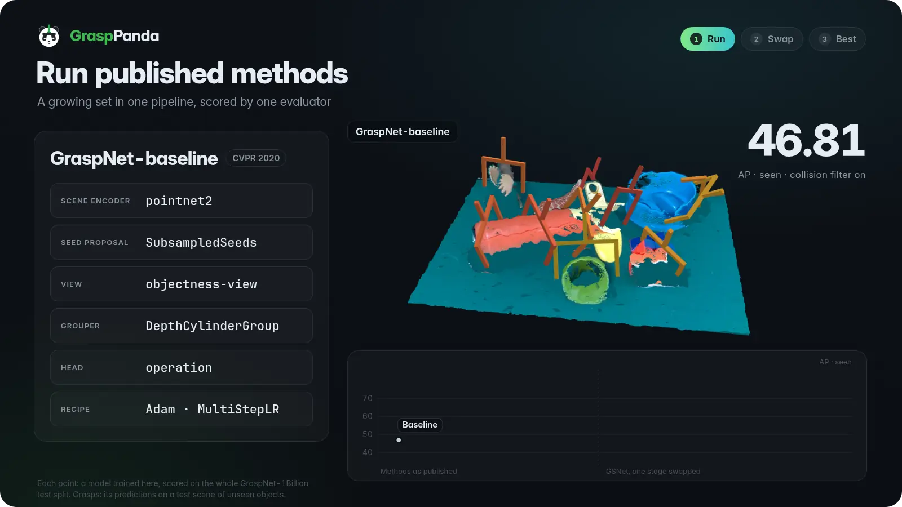
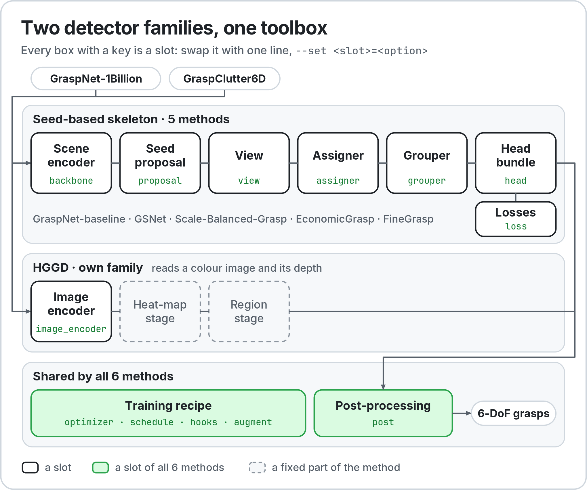

<div align="center">

<picture>
  <source media="(prefers-color-scheme: dark)" srcset="resources/banner-dark.png">
  
</picture>

### 杂乱场景的 6-DoF 抓取检测，一次换一个阶段

持续扩充的已发表方法，同一套 PyTorch 流水线，同一个锁定版本的评测器。

[](https://github.com/Daeda1used/GraspPanda/actions/workflows/test.yml)
[](https://daeda1used.github.io/GraspPanda)
[](LICENSE)

[English](README.md) · **简体中文** ·
[文档（英文）](https://daeda1used.github.io/GraspPanda) ·
[上手试试](#上手试试) ·
[组合浏览器](https://daeda1used.github.io/GraspPanda/explorer/) ·
[结果](#结果)



<sub>每个点都是在这里训练、在 GraspNet-1Billion 整个测试集上评测的一个模型（各训练一次）；抓取是它在一个测试场景上的预测（场景数据采用 CC BY-NC-SA 4.0 许可）。</sub>

</div>

## 为什么做 GraspPanda

杂乱场景抓取检测已经有很强的方法和很好的基准，但各家的数字没法直接比。GSNet 在 GraspNet-1Billion（RealSense，seen）上不加过滤是 65.70 AP，加了是 67.12，而对比表常常拿其中一个去比另一个。HGGD 自己的 README 把 59.36 AP 列为论文结果，把 64.45 列为代码仓库的结果；后来复测它的两篇论文 [RNGNet](https://arxiv.org/abs/2406.01767) 和 [GraRe](https://arxiv.org/abs/2608.00946) 给出的是 58.35 和 63.37。

GraspPanda 让每个方法都走同一套流水线、同一个评测器；这个评测器在 1,592 个记录帧上与 `graspnetAPI` 逐值一致（[测试](tests/integration/test_eval_parity.py)）。每个方法都与参考代码逐阶段一致，下面的每个数字都有提交在仓库里的记录可查。

## 上手试试

用已发表模型的权重，在随包附带的场景上预测抓取，不需要下载数据集。先安装为 CUDA 12.6 或更早版本构建的 PyTorch（稀疏卷积还没有更新版本的构建）：

```bash
pip install torch --index-url https://download.pytorch.org/whl/cu126
git clone https://github.com/Daeda1used/GraspPanda.git && cd GraspPanda
pip install -e ".[spconv-cu126,timm]"
curl -LO \
https://github.com/iSEE-Laboratory/EconomicGrasp/releases/download/v1/economicgrasp_realsense.tar
python -m tools.convert_checkpoint economicgrasp_realsense.tar economicgrasp_realsense.pth \
    --source-format economicgrasp --camera realsense
grasppanda demo economicgrasp/economicgrasp_sunet14_g1b-realsense_10e \
    --weights economicgrasp_realsense.pth --example --collision-filter
```

`demo` 会写出预测的抓取和一张抓取图；`grasppanda env` 会列出装了什么、还需要修什么。每个方法都可以这样运行，输入可以是数据集里的一帧、一张深度图或一个点云：[运行一个方法](https://daeda1used.github.io/GraspPanda/get_started/run_a_method/)。

## 替换一个阶段

<picture>
  <source media="(prefers-color-scheme: dark)" srcset="resources/showcase-dark.svg">
  
</picture>

检测器的每个阶段都是一个槽位。`compose` 一行命令替换一个阶段，检查各阶段间的契约，需要时插入适配器；行不通的组合会被拒绝，并给出原因和修复办法：

```bash
grasppanda compose graspnet_baseline/graspnet-baseline_pointnet2_g1b-realsense_18e \
    --set backbone=ptv3 -o baseline_ptv3.yaml
grasppanda compose hggd/hggd_r34w8_g1b-realsense_15e \
    --set image_encoder=dinov2-small-reg-depth-stem -o hggd_dinov2.yaml
grasppanda probe baseline_ptv3.yaml   # 短暂训练它
```

没有数据集时，probe 只做合成场景检查。PTv3 在全部 5 个基于种子点的方法下都能跑，其中 4 个方法下训练得和原装组件不相上下（FineGrasp 下较差）。DINOv2 编码器在 HGGD 下能跑，但训练得不如 HGGD 的原装组件。`probe` 只说明组合能训练，不说明最终多好：完整训练后，PTv3 比方法原装的编码器低 3.8 到 10.4 AP（[完整训练的替换](https://daeda1used.github.io/GraspPanda/advanced_guides/trained_swaps/)）。

| 槽位 | 适用于 |
|---|---|
| 后处理、训练方案 | 全部方法 |
| 场景编码器、种子点提议、视角、分配器、分组、检测头、损失 | 基于种子点的方法 |
| 图像编码器 | 仅 HGGD |

<details>
<summary>全部槽位，以及一个检测器是怎样组装起来的</summary>

<br>

<picture>
  <source media="(prefers-color-scheme: dark)" srcset="resources/pipeline-dark.png">
  
</picture>

| 槽位 | `--set` 键 | 可以放什么 |
|---|---|---|
| [图像编码器](https://daeda1used.github.io/GraspPanda/slots/image_encoders/) | `image_encoder` | HGGD 的原装组件（内置编码器），以及接到 timm、transformers、torchvision 的桥接 |
| [场景编码器](https://daeda1used.github.io/GraspPanda/slots/scene_encoders/) | `backbone` | 基于点、稀疏体素和 Transformer 的编码器，合适的地方带有已发布的权重 |
| [种子点提议](https://daeda1used.github.io/GraspPanda/slots/proposal/) | `proposal` | 打分或不打分的种子点，及其采样器 |
| [视角](https://daeda1used.github.io/GraspPanda/slots/view/) | `view` | 任意大小的视角网格、回归方向、完整旋转 |
| [分配器](https://daeda1used.github.io/GraspPanda/slots/head_loss/) | `assigner` | 标签如何与预测的抓取对应 |
| [分组](https://daeda1used.github.io/GraspPanda/slots/grouper/) | `grouper` | 在种子点之间或在场景中裁剪：形状、编码器、池化 |
| [检测头](https://daeda1used.github.io/GraspPanda/slots/head_loss/) | `head` | 各移植方法的检测头和一个解耦网格检测头 |
| [损失](https://daeda1used.github.io/GraspPanda/slots/losses/) | `<stage>.<term>_loss`，例如 `head.score_loss` | focal、quality、鲁棒和集合损失，按损失项设置 |
| [后处理](https://daeda1used.github.io/GraspPanda/slots/post/) | `post` | 碰撞、桌面和工作空间过滤、NMS、筛选 |
| [训练方案](https://daeda1used.github.io/GraspPanda/slots/recipe/) | `optimizer`、`schedule`、`hooks`、`augment`、`recipe` | 优化器、学习率调度、钩子、数据增强；调整场景编码器的预设只适用于基于种子点的方法 |

每个选项在哪个方法下能跑，以及为什么不适用于其余方法或没有记录：见[组合浏览器](https://daeda1used.github.io/GraspPanda/explorer/)和[证据页面](https://daeda1used.github.io/GraspPanda/evidence/)。

</details>

## 结果

GraspNet-1Billion（RealSense）上 seen / similar / novel 的 AP：各方法报告的数字，以及按其配置中的训练方案在这里从零训练的结果。

| 方法 | 发表 | 碰撞过滤 | 报告 | 这里训练 |
|---|---|:---:|---|---|
| [GraspNet-baseline](https://daeda1used.github.io/GraspPanda/methods/graspnet_baseline/) | CVPR 2020 | 开 | 47.47 / 42.27 / 16.61 | 46.81 / 41.90 / 16.74 |
| [GSNet](https://daeda1used.github.io/GraspPanda/methods/gsnet/) | ICCV 2021 | 关 | 65.70 / 53.75 / 23.98 | 68.83 / 60.35 / 25.20 |
| [Scale-Balanced-Grasp](https://daeda1used.github.io/GraspPanda/methods/scale_balanced_grasp/) | CoRL 2022 | 关 | 58.95 / 52.97 / 22.63 | 57.23 / 51.13 / 21.98 |
| [EconomicGrasp](https://daeda1used.github.io/GraspPanda/methods/economicgrasp/) | ECCV 2024 | 关 | 68.21 / 61.19 / 25.48 | 69.34 / 61.41 / 26.21 |
| [FineGrasp](https://daeda1used.github.io/GraspPanda/methods/finegrasp/) | arXiv 2025 | 关 | 71.67 / 62.83 / 27.40 | 69.77 / 59.72 / 25.77 |
| [HGGD](https://daeda1used.github.io/GraspPanda/methods/hggd/) | RA-L 2023 | 未说明 · 开 | 64.45 / 53.59 / 24.59 | 63.61 / 54.31 / 24.95 |

GraspNet-baseline 在每个划分上与报告数字相差不超过 1 AP。Scale-Balanced-Grasp、EconomicGrasp 和 HGGD 达到作者权重的成绩；GSNet 高于论文，FineGrasp 低于论文，两处差距原因都尚不清楚。[模型库](https://daeda1used.github.io/GraspPanda/model_zoo/)列出全部数字：碰撞过滤开和关的结果，以及作者权重在这里测得的成绩。这里训练的权重暂未发布；每个方法都可以用作者发布的权重运行。

<details>
<summary>关于这些数字</summary>

<br>

- **GraspNet-baseline** 在本工具箱内训练了一次，与官方仓库公布的数字（说明了碰撞过滤的那一组）相比，每个划分都在准入规则的允许范围内。
- **GSNet** 在本工具箱内从零训练了三次（同一个随机种子），三次的成绩最多相差约一个 AP。它比论文数字高出的幅度超过了准入规则的允许范围，原因尚不清楚。已知的是：移植版与参考实现逐阶段一致；用参考代码训练的模型（标签集有改动）同样高于论文；作者的原始代码没有公开（[详情](https://daeda1used.github.io/GraspPanda/model_zoo/#graspnet-1billion)）。
- **Scale-Balanced-Grasp** 在本工具箱内训练了一次，与作者权重在这里测得的成绩相差约半个 AP 以内。两者在 seen 和 similar 上都比论文低，幅度超出准入规则的允许范围，所以差距不来自训练。
- **EconomicGrasp** 在本工具箱内用同一个随机种子训练了三次。三次的成绩最多相差 1.75 AP，作者权重在这里测得的成绩在每个划分上都落在三次之间。作者权重在 seen 上比论文表格高，幅度略超准入规则的允许范围；表格为什么偏低尚不清楚。
- **FineGrasp** 在本工具箱内训练了一次，成绩低于论文，差距同样超出准入规则的允许范围，原因也尚不清楚。作者的权重在同一套评测下能得到论文的数字，所以差距来自训练；作者训练用的法向图和 graspness 标签没有公开，这里是按论文重新生成的。
- **HGGD** 公开了两组数字：论文的和代码仓库的（即上表那一行），都没有说明是否做碰撞过滤；它发布的测试脚本在保存抓取前会过滤碰撞。在本工具箱内用比公开转换脚本[更密的标签](projects/hggd_labels/)训练，达到作者 RealSense 权重的成绩；用转换脚本原样的标签则远低于作者权重。
- **除 GSNet 外，各方法作者发布的权重**都在本工具箱里跑完了整个测试集，碰撞过滤开、关各一次，即模型库里的 `author-ckpt` 行。它们不是复现。
- **准入规则：** 配置、带 sha256 的权重、训练日志和锁定版本的评测器产出的结果记录，每个划分上相差不超过 1 AP，否则写明差距。

</details>

## 了解更多

- [运行一个方法](https://daeda1used.github.io/GraspPanda/get_started/run_a_method/)：每个方法都能用已发布的权重运行，附许可证和一次实测运行的记录。
- [替换一个组件](https://daeda1used.github.io/GraspPanda/get_started/swap/)：组合、试跑、训练。
- [组合浏览器](https://daeda1used.github.io/GraspPanda/explorer/)：每个选项在每个方法下的实测情况，以及组合被拒绝的原因。
- [设计](https://daeda1used.github.io/GraspPanda/design/ARCHITECTURE/) · [参与贡献](CONTRIBUTING.md) · [更新日志](CHANGELOG.md)

**状态：** alpha。接下来：发布这里训练的权重，在 PyPI 上发布。

## 引用

<details>
<summary>BibTeX</summary>

```bibtex
@software{grasppanda,
  title  = {GraspPanda: A Toolbox for 6-DoF Grasp Detection in Clutter},
  author = {{GraspPanda Contributors}},
  year   = {2026},
  url    = {https://github.com/Daeda1used/GraspPanda}
}
```

也请引用你用到的方法和数据集；每个方法页面都列出了它的参考文献。

</details>

## 致谢

GraspPanda 借鉴了 [PaddleSeg](https://github.com/PaddlePaddle/PaddleSeg)、[MMEngine](https://github.com/open-mmlab/mmengine)、[Detectron2](https://github.com/facebookresearch/detectron2) 和 [Pointcept](https://github.com/Pointcept/Pointcept) 的思路，建立在 [GraspNet-1Billion](https://graspnet.net) 和 [GraspClutter6D](https://huggingface.co/datasets/GraspClutter6D/GraspClutter6D) 基准以及所移植方法的作者的工作之上。方法和评测器依据论文和参考代码的行为编写，没有复制那些仓库的任何文件。改编自 MIT、BSD 或 Apache-2.0 项目的代码列在 [THIRD_PARTY_NOTICES.md](THIRD_PARTY_NOTICES.md) 中；[NOTICE](NOTICE) 说明数据集、上游代码和已发布权重各自的许可证。

🐼 *Panda 指的是熊猫这种动物，不是那款机械臂：GraspPanda 不绑定任何机器人。*

## 许可证

[Apache License 2.0](LICENSE)。数据集、上游仓库和已发布的权重保留各自的许可证，按方法分别注明。
