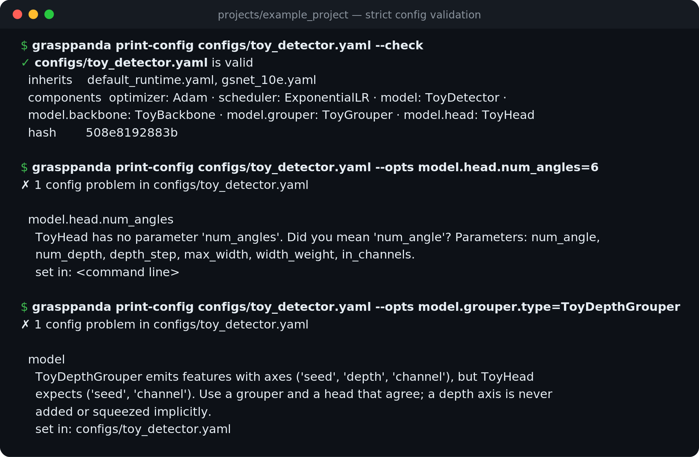
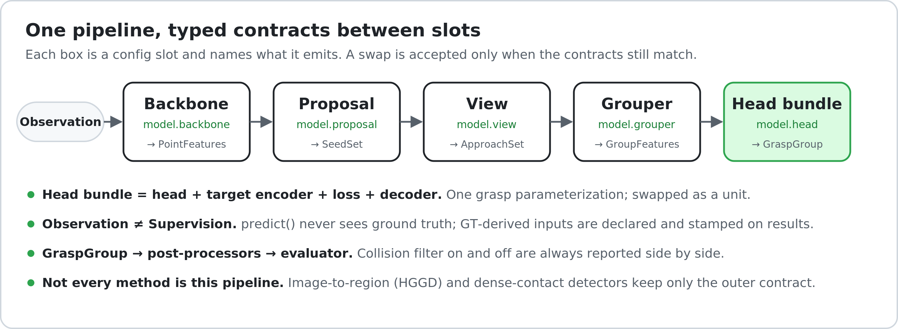

# GraspPanda

**The toolbox for 6-DoF grasp detection in clutter.** Swappable components,
faithful ports, one pinned evaluation.

!!! note "Pre-alpha"
    The framework core is implemented and tested: config system, registries, data
    contracts, reference operators and the CLI. Datasets, the evaluator and the first
    certified method arrive with milestone M1.

## Where to go

| I want to… | Read |
|---|---|
| install it and see it run | [Installation](get_started/installation.md), [Quick start](get_started/quickstart.md) |
| understand the config language | [Configuration](user_guides/config.md) |
| see every component, its contract and where it comes from | [Components](components.md) |
| replace the encoder or another stage of a method | [Swapping components](advanced_guides/swapping.md) |
| add my own backbone, head or detector | [Add a component](advanced_guides/add_component.md) |
| know what the stages pass to each other | [Data contracts](advanced_guides/data_flow.md) |
| see why it is built this way | [Architecture](design/ARCHITECTURE.md) |

## The idea in one picture

The panda is the animal, not the robot arm: GraspPanda is not tied to any robot.
