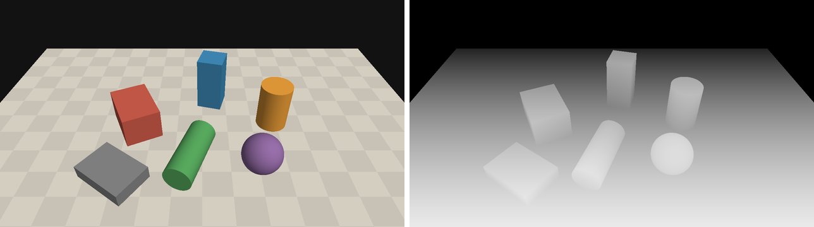

# Inference and visualisation

Three tools take a trained detector off the benchmark:

| Tool | What it does |
|---|---|
| [`grasppanda demo`](#first-grasps-in-five-minutes) | grasps on one frame, as numbers, a picture and an animation |
| [`GraspInferencer`](#from-python) | the same from Python: a depth image or a point cloud in, a `GraspGroup` out |
| [`grasppanda analyze`](#reading-an-analysis) | says where the AP of an evaluation comes from, and how two evaluations differ |

All command output on this page was produced by the commands shown, on the development
machine (one RTX A6000, shared). Paths are as printed.

!!! warning "You bring the weights"
    The model zoo holds no weights yet: nothing has been trained with GraspPanda so far,
    and the checkpoints the authors of the methods released are under their own,
    mostly non-commercial, licences. No grasp checkpoint is downloaded for you (only an
    image-encoder preset with `pretrained: true` fetches backbone weights, through its
    library, and says so). You download an
    author checkpoint yourself, convert it once with `tools/convert_checkpoint.py`, and
    pass the result with `--weights`. Each method's page says where its checkpoint is:
    `configs/<method>/README.md`.

## First grasps in five minutes

### Without downloading anything

The [example project](https://github.com/Daeda1used/GraspPanda/tree/main/projects/example_project)
trains a toy detector on a CPU in about a second. It predicts nothing useful, but it
goes through every step a real method goes through, so it tells you that your
installation works:

```bash
grasppanda train projects/example_project/configs/toy_train.yaml --opts runtime.run_id=toy
grasppanda demo  projects/example_project/configs/toy_train.yaml \
    --weights work_dirs/toy_train/toy/checkpoints/best.pth --example
```

`--example` is a synthetic table-top scene that ships with the package: six geometric
primitives on a table, ray-cast into a 1280 x 720 depth image in millimetres, a colour
image, the camera matrix and an object mask. It is computed from formulas, so it needs no
dataset and carries no dataset licence. It is not a camera image: surfaces are perfectly
smooth and there is no noise, no missing depth and no reflection.



### With a real method

Take GraspNet-baseline: it needs no sparse-convolution library and runs on a CPU. Get
`checkpoint-rs.tar` from the link in
[its page](https://github.com/Daeda1used/GraspPanda/tree/main/configs/graspnet_baseline)
(non-commercial research licence), then:

```bash
python -m tools.convert_checkpoint checkpoint-rs.tar baseline_realsense.pth \
    --source-format graspnet-baseline --camera realsense
grasppanda demo graspnet_baseline/graspnet-baseline_pointnet2_g1b-realsense_18e \
    --weights baseline_realsense.pth --example --collision-filter
```

```text
ʕ•ᴥ•ʔ  GraspPanda 0.1.0  ·  6-DoF grasp detection in clutter
  demo
  config    graspnet_baseline/graspnet-baseline_pointnet2_g1b-realsense_18e.yaml  [shipped config]  (hash 97137012bcda)
  weights   baseline_realsense.pth  (sha256 f24ba97fcf30; 162 matched, 0 missing, 0 unexpected)
  model     GraspNetBaseline on cuda, reads points
  pipeline  data.test: DepthToCloud() -> SegmentationBoxWorkspace(margin=0.02, invalid_depth_foreground='include') -> RandomSample(num_points=20000)
  variants  raw (no post-processing), cd (ModelFreeCollisionFilter)
  input     synthetic example scene: 1280 x 720, 6 primitives on a table, no sensor noise (not a camera image); workspace from the scene's own object mask
  cloud     20,000 points to the model, sampled from 316,254 in the workspace
  grasps    880 predicted in 2.98 s (first call, includes warm-up); 285 left after ModelFreeCollisionFilter

rank  score  x       y       z       width  depth  approach (x, y, z)
────  ─────  ──────  ──────  ──────  ─────  ─────  ─────────────────────
1     1.305  +0.011  -0.122  +0.595  0.091  0.030  (+0.02, +0.49, +0.87)
2     1.245  +0.170  +0.021  +0.597  0.079  0.030  (-0.15, -0.93, -0.34)
3     0.991  +0.135  -0.063  +0.556  0.090  0.020  (+0.02, +0.49, +0.87)
...
camera frame, metres: x right, y down, z forward · approach = first column of the rotation

wrote  work_dirs/graspnet-baseline_pointnet2_g1b-realsense_18e/demo/grasps.npy  (285, 17) float32, GraspNet layout, best first
       work_dirs/graspnet-baseline_pointnet2_g1b-realsense_18e/demo/grasps.png  the cloud and the 30 best grasps, red (lowest shown) to green
       work_dirs/graspnet-baseline_pointnet2_g1b-realsense_18e/demo/grasps.gif  24 frames swinging around the scene
       work_dirs/graspnet-baseline_pointnet2_g1b-realsense_18e/demo/example  the scene as files: depth.png, rgb.png, mask.png, intrinsics.txt
```

What the lines say:

- **pipeline** is the test pipeline of the config, step by step. The demo runs exactly
  these steps on the input; it has no preprocessing of its own.
- **cloud**: the workspace crop left 316,254 points and the model was given 20,000 of them.
- **grasps**: how many the model emitted, and how many the collision filter kept. The
  time is that of the first call, which includes loading GPU kernels; later calls are
  faster. On the CPU of the same machine (`--device cpu`) this call took 1.0 s.
- The picture draws the 30 best grasps (`--top-k`) as wire-frame grippers, coloured by
  score rank. `--show` opens the same scene in an interactive Open3D window if you have
  a display and `pip install -e ".[vis]"`.

What the result does **not** say: how good the method is. The scene is synthetic and
outside the training distribution of every model here; whether a grasp would hold is
not checked. For numbers, see [Training and testing](train_test.md) and
[Reading an analysis](#reading-an-analysis).

### The five methods

Every shipped method runs through the same command. What differs is what each reads and
how its authors' checkpoint is converted:

| Method | Config | Reads | `--source-format` | Needs |
|---|---|---|---|---|
| GraspNet-baseline | `graspnet_baseline/graspnet-baseline_pointnet2_g1b-realsense_18e` | points | `graspnet-baseline` | nothing extra |
| Scale-Balanced-Grasp | `scale_balanced_grasp/sbg_pointnet2-transformer_g1b-realsense_18e` | points | `scale-balanced-grasp` | nothing extra |
| HGGD | `hggd/hggd_r34w8_g1b-realsense_15e` (or `-kinect_`) | colour and depth images, intrinsics, points | `hggd` | a colour image |
| GSNet | `gsnet/gsnet_sunet14_g1b-realsense_10e` | points | `graspness-unofficial` | an `spconv` extra |
| EconomicGrasp | `economicgrasp/economicgrasp_sunet14_g1b-realsense_10e` (or `-kinect_`) | points | `economicgrasp` | an `spconv` extra |

All five were run with `--example --collision-filter` and on a GraspNet-1Billion frame
while this page was written. Weights for a RealSense config were trained on RealSense
D435 images, weights for a Kinect config on Azure Kinect images.

## Your own camera

### What you need

- A **depth image**: single-channel, 16-bit PNG or TIFF (or a `.npy`). An integer image is
  read as millimetres, a float image as metres; `--depth-scale N` says otherwise (`N`
  depth units per metre).
- The **intrinsics** of the depth camera in pixels: `--intrinsics fx,fy,cx,cy`, or a
  file holding those four numbers or the 3 x 3 camera matrix. They must be the intrinsics
  of the resolution the image has.
- For HGGD, the **colour image registered to the depth image**, pixel for pixel
  (`--rgb`). Point-cloud methods ignore it, except to colour the picture.

```bash
grasppanda demo graspnet_baseline/graspnet-baseline_pointnet2_g1b-realsense_18e \
    --weights baseline_realsense.pth --depth camera/depth.png --intrinsics 925,925,640,360 \
    --workspace -0.25 -0.2 0.35 0.25 0.2 0.8 --collision-filter --out work_dirs/camera_baseline
```

```text
  input     camera/depth.png: 1280 x 720 uint16, read as millimetres
  cloud     20,000 points to the model, sampled from 445,990 in the workspace
  grasps    942 predicted in 3.51 s (first call, includes warm-up); 240 left after ModelFreeCollisionFilter
```

(The files here are the example scene, written to disk by `--example`. They stand in for
a camera so that the command can be shown with its output.)

### The workspace matters

The point-cloud methods were trained and tested on clouds cropped to the objects: the
GraspNet-1Billion pipelines crop to a box around the **ground-truth** segmentation, at
test time too (which is why their results are stamped `gt_assisted: [workspace]`). Your
camera has no ground truth. The inferencer does not pretend otherwise; it does what the
input allows and says what it did:

| You pass | What happens |
|---|---|
| `--workspace XMIN YMIN ZMIN XMAX YMAX ZMAX` | only points inside this box of the camera frame are kept (metres; x right, y down, z forward) |
| `--mask FILE` (object pixels non-zero, from any segmentation) and `--table-from-camera FILE` | the config's own provider runs, with your mask in the place of the dataset's segmentation |
| `--mask FILE` alone | the same kind of crop with the box aligned to the camera axes instead of the table; a note says so |
| nothing | every pixel with depth is used, and a note says what that means |

The note of the last case, as printed:

```text
  note      The test pipeline of this config crops the cloud with SegmentationBoxWorkspace, which reads a ground-truth segmentation; the weights were trained and tested on clouds cropped that way. No mask was given, so every pixel with depth is used. Expect grasps on the surroundings too and fewer points on the objects; pass mask=... (object pixels) or workspace=... (a box in the camera frame) to restrict the input.
  cloud     20,000 points to the model, sampled from 699,022 in the workspace
```

HGGD is the exception: its pipeline has no workspace (`NoWorkspace`), it reads the whole
image.

```bash
grasppanda demo hggd/hggd_r34w8_g1b-realsense_15e --weights hggd_realsense.pth \
    --depth camera/depth.png --rgb camera/rgb.png --intrinsics 925,925,640,360 --collision-filter
```

```text
  model     HGGD on cuda, reads depth, intrinsics, points, rgb
  pipeline  data.test: DepthToCloud() -> NoWorkspace() -> RandomSample(num_points=25600)
  variants  raw (no post-processing), cd (ModelFreeCollisionFilter + GraspNMS)
  input     camera/depth.png: 1280 x 720 uint16, read as millimetres; colour camera/rgb.png
  cloud     25,600 points to the model
  grasps    470 predicted in 4.09 s (first call, includes warm-up); 72 left after ModelFreeCollisionFilter + GraspNMS
```

### The usual mistakes

Each ends with exit code 1 and one line that says what to change. Verbatim:

```text
$ grasppanda demo ... --depth camera/depth.png
✗ InputError: --depth needs --intrinsics fx,fy,cx,cy: the focal lengths and the principal point of the depth camera in pixels. Without them a depth image cannot become a point cloud. Your camera's SDK reports them (RealSense: rs-enumerate-devices -c).

$ grasppanda demo ... --depth camera/depth.png --intrinsics 925,925,640,360 --depth-scale 1
✗ InputError: the depth image (median value 545, depth_scale=1) has a median range of 545 m. The values are probably millimetres: pass depth_scale=1000 (--depth-scale 1000).

$ grasppanda demo ... --depth camera/depth.png --intrinsics 925,925,640,360 --workspace -0.2 -0.2 1.5 0.2 0.2 2.0
✗ InputError: the workspace is empty: no pixel with depth lies inside it (CameraBoxWorkspace). The cloud spans x -0.45 to 0.45, y -0.19 to 0.16, z 0.42 to 0.84 metres in the camera frame (x right, y down, z forward).

$ grasppanda demo hggd/hggd_r34w8_g1b-realsense_15e --weights hggd_realsense.pth --depth camera/depth.png --intrinsics 925,925,640,360
✗ InputError: HGGD reads the colour image; pass the colour image registered to the depth image: rgb=... (--rgb FILE)
```

Intrinsics of another resolution, a colour image of another size than the depth image,
a colour-mapped picture of depth instead of a depth image, and a cloud in millimetres are
refused in the same way.

### Point clouds and dataset frames

`--points cloud.npy|.ply|.pcd` takes a cloud in the camera frame, in metres, that you
have already cropped to the workspace. The image-space steps of the pipeline do not
apply to it; sampling and input features do. A method that reads images refuses it and
lists what it needs instead.

`--frame graspnet1b:scene_0100/realsense/0000` reads a frame of the dataset the config
names, through the config's own dataset reader:

```text
  input     dataset frame graspnet1b:scene_0100/realsense/0000, read by the config's dataset reader
  cloud     15,000 points to the model, sampled from 519,612 in the workspace; ground-truth-assisted inputs: workspace
  grasps    1024 predicted in 2.58 s (first call, includes warm-up); 816 left after ModelFreeCollisionFilter
```

The grasps are those `grasppanda test` dumps for that frame. This is tested, not
assumed (`tests/integration/test_inference_api.py`): for GraspNet-baseline,
Scale-Balanced-Grasp, GSNet and EconomicGrasp the arrays are bit-identical to the
engine's dump on all eight frames compared, raw and collision-filtered, and the same
holds for GSNet on GraspClutter6D frames. HGGD draws random numbers while it predicts
(it jitters its regions). A test run seeds once and draws frame after frame; a call
here seeds per call. HGGD therefore reproduces the first frame of a run (within 1e-5;
two runs of the same GPU kernels differ by 2e-7) and gives another, equally valid, draw
for later frames.

## From Python

```python
import numpy as np
from PIL import Image

from grasppanda import GraspInferencer

inferencer = GraspInferencer(
    "graspnet_baseline/graspnet-baseline_pointnet2_g1b-realsense_18e", "baseline_realsense.pth"
)
depth = np.array(Image.open("camera/depth.png"))  # (720, 1280) uint16, millimetres
grasps = inferencer(
    depth=depth,
    intrinsics=(925.0, 925.0, 640.0, 360.0),  # fx, fy, cx, cy in pixels
    depth_scale=1000.0,  # depth units per metre
    workspace=(-0.25, -0.2, 0.35, 0.25, 0.2, 0.8),  # a box in the camera frame, metres
    collision_filter=True,
)
best = grasps.sort_by_score()[0]
print(len(grasps), "grasps in frame", repr(grasps.frame), "score:", grasps.score_kind)
print("grasp point   ", best.translation[0].tolist())
print("approach axis ", best.rotation[0, :, 0].tolist())
print("width, depth  ", float(best.width), float(best.depth))
print("array         ", grasps.to_graspnet_array().shape, grasps.to_graspnet_array().dtype)
```

```text
240 grasps in frame 'camera' score: predicted_quality_x_tolerance
grasp point    [-0.23671351373195648, -0.01879783719778061, 0.6439999938011169]
approach axis  [0.022774772718548775, 0.4925254285335541, 0.8700000047683716]
width, depth   0.10000000149011612 0.009999999776482582
array          (240, 17) float32
```

The call takes exactly one kind of input: `depth=` with `intrinsics=` (and `rgb=`,
`mask=`, `depth_scale=`, `table_from_camera=`, `workspace=`), or `points=`, or
`frame=`. It returns a [`GraspGroup`](../api/structures.md):

| Field | Meaning |
|---|---|
| `translation` `(G, 3)` | the grasp point between the fingers, metres |
| `rotation` `(G, 3, 3)` | column 0 the approach direction, column 1 the closing direction, column 2 the finger-height direction |
| `width` `(G,)` | jaw opening, metres |
| `depth` `(G,)` | how far the fingers reach past the grasp point along the approach, metres |
| `score` `(G,)` | higher is better; `score_kind` says what it is. It is not a calibrated probability |
| `frame` | `camera`: the optical frame of the depth sensor, x right, y down, z forward |

`to_graspnet_array()` gives the 17 columns other GraspNet tools read:
`[score, width, height, depth, R (9, row-major), t (3), object_id]`. To move the grasps
into your robot's base frame, apply your hand-eye calibration as a 4 x 4 tensor:
`grasps.transform(base_from_camera, frame="base")`.

Things worth knowing:

- **Order.** Grasps come in the order the detector emits them. Use `sort_by_score()`.
- **Repeatable.** Point sampling and the detector's random draws are seeded per call, from
  the config (`data.<split>.dataset.seed`, `runtime.seed`), so the same input gives the
  same grasps. `seed=` changes both.
- **Post-processing.** `collision_filter=True` applies the config's variant that holds a
  collision filter (`cd` in the shipped configs); `variant="name"` applies any chain of
  `evaluation.variants`. The filter tests the gripper against the observed points only;
  it knows nothing about what the camera did not see.
- **Two halves.** `inferencer.observe(...)` returns the `Observation` the model reads (the
  sampled cloud, the cloud before sampling, the images), `inferencer.predict(observation)`
  the grasps. Use them to look at what the pipeline did to your input.
- **Warnings.** Differences from the conditions of the test pipeline (no mask where the
  pipeline crops with one, a cloud that cannot be checked for a crop) are raised once per
  inferencer as `InferenceWarning`.

### What is not claimed

The weights were trained on GraspNet-1Billion: two cameras, 1280 x 720, objects on a
table 0.4 to 0.7 m away. Nothing here has been measured on another camera, another
resolution or a real robot. HGGD needs an image whose size is a multiple of its 640 x 360
network input, with the same aspect ratio. Treat grasps on your own data as predictions
of a model outside its test conditions until you have checked them on your setup.

## Reading an analysis

`grasppanda test` writes one result record per post-processing variant into
`<run>/results/`. `grasppanda analyze` reads those records and nothing else: no dataset,
no weights, no predictions.

```bash
grasppanda test graspnet_baseline/graspnet-baseline_pointnet2_g1b-realsense_18e \
    --weights baseline_realsense.pth \
    --opts data.test.dataset.split=test_seen data.test.dataset.frame_step=64 \
    runtime.work_dir=work_dirs/baseline runtime.run_id=test_seen_step64 evaluation.num_workers=4
grasppanda analyze work_dirs/baseline --variant cd --objects 5 --plot work_dirs/baseline_cd.png
```

```text
work_dirs/baseline/test_seen_step64 · cd
  protocol        graspnet1b-sv-v1 · dataset graspnet1b · split test_seen · camera realsense
  coverage        120 of 120 frames scored (100.0 %), 0 missing
  extent          a SUBSET of split 'test_seen': 120 of its 7,680 frames (4 of 256 frames per scene, 30 of 30 scenes). Not a benchmark number.
  inputs          ground-truth-assisted: workspace
  post-processing ModelFreeCollisionFilter
  provenance      weights sha256 f24ba97fcf30 · code de7d468efc · seed 0 · 2026-10-12T16:31:51+00:00
  metrics         AP 0.4867 · AP0.4 0.4178 · AP0.8 0.5764   (fraction in [0, 1]; multiply by 100 for the figures papers print)

Where the precision comes from
friction threshold  μ≤0.2   μ≤0.4   μ≤0.6   μ≤0.8   μ≤1     μ≤1.2   mean
──────────────────  ──────  ──────  ──────  ──────  ──────  ──────  ──────
mean precision      0.1788  0.4178  0.5299  0.5764  0.6005  0.6166  0.4867

Share of every frame's AP by outcome of the rank that owns it (earned = the precision above):
outcome                 μ≤0.2   μ≤0.4   μ≤0.6   μ≤0.8   μ≤1     μ≤1.2   mean
──────────────────────  ──────  ──────  ──────  ──────  ──────  ──────  ──────
earned                  0.1788  0.4178  0.5299  0.5764  0.6005  0.6166  0.4867
lost: no force closure  0.5214  0.2824  0.1703  0.1238  0.0997  0.0836  0.2135
lost: collision         0.2931  0.2931  0.2931  0.2931  0.2931  0.2931  0.2931
lost: empty             0.0067  0.0067  0.0067  0.0067  0.0067  0.0067  0.0067
lost: unfilled ranks    0.0001  0.0001  0.0001  0.0001  0.0001  0.0001  0.0001
sum                     1.0000  1.0000  1.0000  1.0000  1.0000  1.0000  1.0000

By split
split      scenes  frames  mean    μ≤0.2   μ≤0.4   μ≤0.6   μ≤0.8   μ≤1     μ≤1.2
─────────  ──────  ──────  ──────  ──────  ──────  ──────  ──────  ──────  ──────
test_seen  30/30   120     0.4867  0.1788  0.4178  0.5299  0.5764  0.6005  0.6166

By scene (the 5 lowest and the 5 highest of 30; --scenes 0 lists all)
scene                 frames  mean precision  AP0.8   AP0.4   grasps/frame
────────────────────  ──────  ──────────────  ──────  ──────  ────────────
realsense/scene_0122  4       0.1866          0.2482  0.0967  155.0
realsense/scene_0124  4       0.3077          0.3535  0.2674  163.2
realsense/scene_0111  4       0.3347          0.3861  0.2471  147.0
realsense/scene_0100  4       0.3417          0.4168  0.2924  132.0
realsense/scene_0101  4       0.3905          0.4546  0.3111  125.5
…
realsense/scene_0121  4       0.6018          0.6721  0.5533  195.8
realsense/scene_0113  4       0.6135          0.7400  0.4962  204.2
realsense/scene_0116  4       0.6322          0.7470  0.6038  193.5
realsense/scene_0119  4       0.6798          0.7911  0.6571  173.8
realsense/scene_0114  4       0.6934          0.8047  0.7022  177.0

By object (the 5 that lose most of 28; percentage points of AP, mean over the friction thresholds)
object  frames  ranked/frame  earned  no closure  collision  empty  success
──────  ──────  ────────────  ──────  ──────────  ─────────  ─────  ───────
0       40      8.5           3.07    1.01        4.99       0.13   0.334
7       40      8.8           3.29    1.95        2.65       0.00   0.417
58      40      9.8           7.78    1.88        2.53       0.18   0.629
66      40      9.6           4.51    2.08        2.16       0.00   0.515
8       40      8.9           2.09    1.69        1.67       0.04   0.381
  earned sums to the AP over all objects; success = earned / (earned + lost), rank-weighted

Grasps
  stage                           grasps  per frame  removed by this step  left of the predicted
  ──────────────────────────────  ──────  ─────────  ────────────────────  ─────────────────────
  predicted                       47,812  398.4
  after ModelFreeCollisionFilter  19,235  160.3      59.8 %                40.2 %
  frames with an empty prediction: 0

wrote work_dirs/baseline_cd.png
```

### The header

The first block is everything a number needs before it may be quoted: protocol, split
and camera, how many frames were scored, which inputs were derived from ground truth,
the post-processing chain, and the weights and code that produced it. **extent** compares
the frames of the record with the split it names. This run scored every 64th frame, so
it is a subset, and the report says so in capitals. The weights are the authors' RealSense
checkpoint, converted (provenance `author-ckpt`), and the collision filter ran. Its AP of
0.4867 is a measurement on 120 frames; it is not the AP of GraspNet-baseline on the seen
split.

### Where the precision comes from

AP is the mean of a precision table with one column per friction threshold μ. The first
table gives the mean of each column; their mean is the AP. Here a grasp that needs
μ ≤ 0.2 is rare (0.18), and most of what can be earned is earned by μ ≤ 0.8.

The second table attributes the AP. A frame's AP is a weighted sum over its 50 ranks:
rank 1 owns about 9 % of it, rank 50 owns 0.04 %. Every rank either earns its share, or
loses it for exactly one reason: the gripper collides with the scene (checked against
the ground-truth models), nothing is between the fingers, the grasp is free but not
force-closed at this μ, or the rank was never filled. The columns add up to one. In
this run 29 % of the AP is lost to collisions although the model-free collision filter
ran, and at μ ≤ 0.8 another 12 % to grasps that are free but do not hold.

**By object** applies the same split to the object each ranked grasp belongs to. The
numbers are percentage points of AP: object 0 earns 3.07 points and loses 4.99 to
collisions, more than any other object. `success` is the share an object's ranks earned
of what they held. Object ids are the dataset's.

**By scene** lists the scenes at both ends. Scenes, not frames, are the unit to think
in: the four frames of a scene show the same objects.

**Grasps** follows the predictions through the post-processing chain. For a chain with
two steps each step has its own row. HGGD's `cd` variant on the same frames:

```text
Grasps
  stage                           grasps  per frame  removed by this step  left of the predicted
  ──────────────────────────────  ──────  ─────────  ────────────────────  ─────────────────────
  predicted                       53,917  449.3
  after ModelFreeCollisionFilter  25,908  215.9      51.9 %                48.1 %
  after GraspNMS                  7,954   66.3       69.3 %                14.8 %
  frames with an empty prediction: 0
```

The split by cause and object and the per-step counts are stored in the record by
`grasppanda test` (fields `breakdown` and `grasp_counts`). Records written before these
fields existed are read as before; the report then gives the total the chain removed,
from the grasp counts of the run's records, and says that the rest is not recorded.

### Comparing two results

```bash
grasppanda analyze --compare work_dirs/baseline:cd work_dirs/sbg:cd --scenes 5 \
    --plot work_dirs/baseline_vs_sbg.png
```

```text
A  work_dirs/baseline/test_seen_step64 · cd
B  work_dirs/sbg/test_seen_step64 · cd
   protocol graspnet1b-sv-v1 · dataset graspnet1b · 30 paired scenes
   differs: weights: A f24ba97fcf30 · B e6696a21baf5

Paired summary over scenes (mean precision of a scene; B − A)
  mean A 0.4867 · mean B 0.6284 · mean difference +0.1417 · median +0.1371 · standard deviation 0.0788
  95 % interval of the mean difference +0.1154 to +0.1698 (bootstrap over the 30 scenes, 10 000 resamples, seed 0)
  B higher in 30 scenes, A higher in 0, equal in 0 · two-sided sign test p = 1.86e-09

Per scene, largest difference first (the 5 largest of 30; --scenes 0 lists all)
scene                 A       B       B − A
────────────────────  ──────  ──────  ───────
realsense/scene_0122  0.1866  0.5417  +0.3551
realsense/scene_0124  0.3077  0.6321  +0.3244
realsense/scene_0118  0.4546  0.6887  +0.2342
realsense/scene_0101  0.3905  0.6088  +0.2183
realsense/scene_0111  0.3347  0.5298  +0.1951
```

`A:cd` picks a variant of a run; `--variant` picks one for both. The two records must
share protocol and dataset. Whatever else differs between them (split, cameras,
ground-truth-assisted inputs, post-processing, weights, code) is listed under `differs`,
so that a difference in the numbers is not credited to the wrong cause.

The summary pairs scenes. The interval is a bootstrap over the paired scenes and the
sign test counts in how many scenes each side is ahead; both treat a scene as one
observation. On this subset Scale-Balanced-Grasp is ahead in all 30 scenes. Both are
author checkpoints scored on 120 frames; the statement is about these 120 frames.

`--plot` draws the report: for one record the precision per friction threshold, the
share earned and lost, and every scene; for a comparison the difference of every scene
around zero. It uses Pillow only, like the renderer of `grasppanda demo`.
