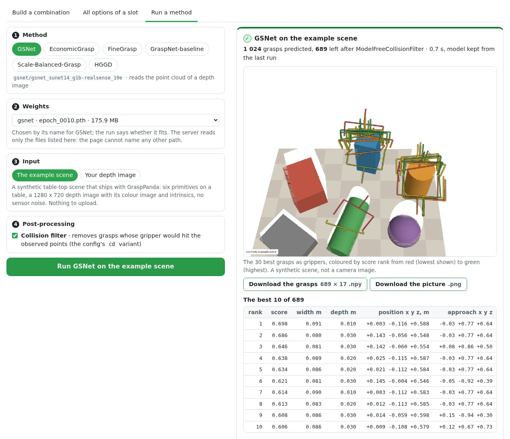

# Your camera and Python

**Goal:** get grasps from a trained detector on frames of your own camera: on the command
line, from Python, or in a browser page.

**You need:** weights for one of the six methods. GraspPanda downloads no grasp checkpoint:
you take the released file yourself, under its licence, and convert it once. Each method
page walks through it, with the file, its licence and the command, then a first picture of
the example scene:
[GraspNet-baseline](../methods/graspnet_baseline.md#run-in-five-minutes),
[GSNet](../methods/gsnet.md#run-in-five-minutes),
[Scale-Balanced-Grasp](../methods/scale_balanced_grasp.md#run-in-five-minutes),
[EconomicGrasp](../methods/economicgrasp.md#run-in-five-minutes),
[FineGrasp](../methods/finegrasp.md#run-in-five-minutes),
[HGGD](../methods/hggd.md#run-in-five-minutes).
Weights you trained yourself work the same way ([Train and test](train_test.md)).

## Your own camera

1. **A depth image**: single-channel, 16-bit PNG or TIFF, or a `.npy`. An integer image is
   read as millimetres, a float image as metres; `--depth-scale N` says otherwise (`N`
   depth units per metre).
2. **The intrinsics** of the depth camera in pixels, for the resolution the image has:
   `--intrinsics fx,fy,cx,cy`, or a file with those four numbers or the 3 × 3 matrix.
3. **A crop of the workspace** (see below), and for HGGD **the colour image** registered to
   the depth image pixel for pixel (`--rgb`).

Then run `grasppanda demo` with the config of your weights:

=== "GraspNet-baseline"

    ```bash
    grasppanda demo graspnet_baseline/graspnet-baseline_pointnet2_g1b-realsense_18e \
        --weights baseline_realsense.pth --collision-filter \
        --depth camera/depth.png --intrinsics 925,925,640,360 \
        --workspace -0.25 -0.2 0.35 0.25 0.2 0.8
    ```

=== "GSNet"

    ```bash
    grasppanda demo gsnet/gsnet_sunet14_g1b-realsense_10e \
        --weights gsnet_realsense.pth --collision-filter \
        --depth camera/depth.png --intrinsics 925,925,640,360 \
        --workspace -0.25 -0.2 0.35 0.25 0.2 0.8
    ```

    Needs the sparse-convolution extra ([Install](../get_started/installation.md)).

=== "Scale-Balanced-Grasp"

    ```bash
    grasppanda demo scale_balanced_grasp/sbg_pointnet2-transformer_g1b-realsense_18e \
        --weights sbg_realsense.pth --collision-filter \
        --depth camera/depth.png --intrinsics 925,925,640,360 \
        --workspace -0.25 -0.2 0.35 0.25 0.2 0.8
    ```

=== "EconomicGrasp"

    ```bash
    grasppanda demo economicgrasp/economicgrasp_sunet14_g1b-realsense_10e \
        --weights economicgrasp_realsense.pth --collision-filter \
        --depth camera/depth.png --intrinsics 925,925,640,360 \
        --workspace -0.25 -0.2 0.35 0.25 0.2 0.8
    ```

    Needs the sparse-convolution extra ([Install](../get_started/installation.md)).

=== "FineGrasp"

    ```bash
    grasppanda demo finegrasp/finegrasp_sunet14_g1b-realsense_10e \
        --weights finegrasp_realsense.pth --collision-filter \
        --depth camera/depth.png --intrinsics 925,925,640,360 \
        --workspace -0.25 -0.2 0.35 0.25 0.2 0.8
    ```

    Needs the sparse-convolution extra. FineGrasp also computes the surface normal of every
    point from the depth image.

=== "HGGD"

    ```bash
    grasppanda demo hggd/hggd_r34w8_g1b-realsense_15e \
        --weights hggd_realsense.pth --collision-filter \
        --depth camera/depth.png --rgb camera/rgb.png --intrinsics 925,925,640,360
    ```

    HGGD reads the whole image and crops nothing. Its image must be a multiple of its
    640 × 360 network input, with the same aspect ratio.

It prints the pipeline, the cloud, how many grasps were predicted and how many the
collision filter kept, and the best ten. It writes `grasps.npy` (`(G, 17)`, GraspNet layout,
best first, camera frame, metres), a picture and an animation into `work_dirs/<config name>/demo/`.
Add `--out DIR` to choose the folder, `--show` for an interactive window
(`pip install -e ".[vis]"`).

??? note "What it prints (GraspNet-baseline, on the example scene saved as files)"

    The files under `camera/` are the example scene that `--example` writes to disk; they
    stand in for a camera so that the command can be shown with its output.

    ```text
      input     camera/depth.png: 1280 x 720 uint16, read as millimetres
      cloud     20,000 points to the model, sampled from 445,990 in the workspace
      grasps    942 predicted in 3.51 s (first call, includes warm-up); 240 left after ModelFreeCollisionFilter
    ```

### The workspace matters

GraspNet-baseline, GSNet, Scale-Balanced-Grasp, EconomicGrasp and FineGrasp were trained
and tested on clouds cropped to the objects: their GraspNet-1Billion pipelines crop to a
box around the **ground-truth** segmentation, at test time too (which is why their results
are stamped `gt_assisted: [workspace]`). HGGD crops nothing. Your camera has no ground
truth. The inferencer does what the input allows and says what it did:

| You pass | What happens |
|---|---|
| `--workspace XMIN YMIN ZMIN XMAX YMAX ZMAX` | only points inside this box of the camera frame are kept (metres; x right, y down, z forward) |
| `--mask FILE` (object pixels non-zero, from any segmentation) and `--table-from-camera FILE` | the config's own crop runs, with your mask in the place of the dataset's segmentation |
| `--mask FILE` alone | the same kind of crop with the box aligned to the camera axes instead of the table; a note says so |
| nothing | every pixel with depth is used, and a note says what that means |

??? note "The note printed when nothing restricts the input"

    ```text
      note      The test pipeline of this config crops the cloud with SegmentationBoxWorkspace, which reads a ground-truth segmentation; the weights were trained and tested on clouds cropped that way. No mask was given, so every pixel with depth is used. Expect grasps on the surroundings too and fewer points on the objects; pass mask=... (object pixels) or workspace=... (a box in the camera frame) to restrict the input.
      cloud     20,000 points to the model, sampled from 699,022 in the workspace
    ```

??? note "Troubleshooting: the usual mistakes, verbatim"

    Each ends with exit code 1 and one line that says what to change.

    ```text
    $ grasppanda demo ... --depth camera/depth.png
    ✗ InputError: --depth needs --intrinsics fx,fy,cx,cy: the focal lengths and the principal point of the depth camera in pixels. Without them a depth image cannot become a point cloud. Your camera's SDK reports them (RealSense: rs-enumerate-devices -c).

    $ grasppanda demo ... --depth camera/depth.png --intrinsics 925,925,640,360 --depth-scale 1
    ✗ InputError: the depth image (median value 545, depth_scale=1) has a median range of 545 m. The values are probably millimetres: pass depth_scale=1000 (--depth-scale 1000).

    $ grasppanda demo ... --depth camera/depth.png --intrinsics 925,925,640,360 --workspace -0.2 -0.2 1.5 0.2 0.2 2.0
    ✗ InputError: the workspace is empty: no pixel with depth lies inside it (CameraBoxWorkspace). The cloud spans x -0.45 to 0.45, y -0.19 to 0.16, z 0.42 to 0.84 metres in the camera frame (x right, y down, z forward).

    $ grasppanda demo hggd/hggd_r34w8_g1b-realsense_15e --weights hggd_realsense.pth --depth camera/depth.png --intrinsics 925,925,640,360
    ✗ InputError: HGGD reads the colour image; pass the colour image registered to the depth image: rgb=... (--rgb FILE)
    ```

    Intrinsics of another resolution, a colour image of another size than the depth image,
    a colour-mapped picture of depth instead of a depth image, and a cloud in millimetres are
    refused in the same way.

??? note "Point clouds and dataset frames"

    `--points cloud.npy|.ply|.pcd` takes a cloud in the camera frame, in metres, that you
    have already cropped to the workspace. The image-space steps of the pipeline do not
    apply to it; sampling and input features do. A method that reads images refuses it and
    lists what it needs instead.

    `--frame graspnet1b:scene_0100/realsense/0000` reads a frame of the dataset the config
    names, through the config's own dataset reader. With the GSNet config (its recipe
    samples 15 000 points):

    ```text
      input     dataset frame graspnet1b:scene_0100/realsense/0000, read by the config's dataset reader
      cloud     15,000 points to the model, sampled from 519,612 in the workspace; ground-truth-assisted inputs: workspace
      grasps    1024 predicted in 2.58 s (first call, includes warm-up); 816 left after ModelFreeCollisionFilter
    ```

    The grasps are those `grasppanda test` dumps for that frame
    (`tests/integration/test_inference_api.py`): for GraspNet-baseline, GSNet,
    Scale-Balanced-Grasp and EconomicGrasp the arrays are bit-identical to the
    engine's dump on all eight frames compared, raw and collision-filtered, and the same
    holds for GSNet on GraspClutter6D frames. FineGrasp is not in that test. HGGD draws
    random numbers while it predicts (it jitters its regions): a test run seeds once and
    draws frame after frame, a call here seeds per call. HGGD therefore reproduces the first
    frame of a run (within 1e-5) and gives another, equally valid, draw for later frames.

## From Python

```python
import numpy as np
from PIL import Image
from grasppanda import GraspInferencer

inferencer = GraspInferencer("<method config>", "<weights>.pth")
depth = np.array(Image.open("camera/depth.png"))  # (720, 1280) uint16, millimetres
grasps = inferencer(
    depth=depth, intrinsics=(925.0, 925.0, 640.0, 360.0), depth_scale=1000.0,
    workspace=(-0.25, -0.2, 0.35, 0.25, 0.2, 0.8), collision_filter=True,
)
best = grasps.sort_by_score()[0]
```

The config and weights are those of the commands above (HGGD also takes `rgb=`). The call
takes exactly one kind of input: `depth=` with `intrinsics=` (and `rgb=`, `mask=`,
`depth_scale=`, `table_from_camera=`, `workspace=`), or `points=`, or `frame=`. It returns
a [`GraspGroup`](../api/structures.md) in the camera frame, in metres.

??? note "The fields of a grasp, and an example output"

    | Field | Meaning |
    |---|---|
    | `translation` `(G, 3)` | the grasp point between the fingers, metres |
    | `rotation` `(G, 3, 3)` | column 0 the approach direction, column 1 the closing direction, column 2 the finger-height direction |
    | `width` `(G,)` | jaw opening, metres |
    | `depth` `(G,)` | how far the fingers reach past the grasp point along the approach, metres |
    | `score` `(G,)` | higher is better; `score_kind` says what it is. It is not a calibrated probability |
    | `frame` | `camera`: the optical frame of the depth sensor, x right, y down, z forward |

    `to_graspnet_array()` gives the 17 columns other GraspNet tools read:
    `[score, width, height, depth, R (9, row-major), t (3), object_id]`. To move the grasps
    into your robot's base frame, apply your hand-eye calibration as a 4 × 4 tensor:
    `grasps.transform(base_from_camera, frame="base")`.

    With the GraspNet-baseline config and `baseline_realsense.pth`, on the files above:

    ```python
    print(len(grasps), "grasps in frame", repr(grasps.frame), "score:", grasps.score_kind)
    print("grasp point   ", best.translation[0].tolist())
    print("approach axis ", best.rotation[0, :, 0].tolist())
    print("width, depth  ", float(best.width), float(best.depth))
    ```

    ```text
    240 grasps in frame 'camera' score: predicted_quality_x_tolerance
    grasp point    [-0.23671351373195648, -0.01879783719778061, 0.6439999938011169]
    approach axis  [0.022774772718548775, 0.4925254285335541, 0.8700000047683716]
    width, depth   0.10000000149011612 0.009999999776482582
    ```

??? note "Things worth knowing"

    - **Order.** Grasps come in the order the detector emits them. Use `sort_by_score()`.
    - **Repeatable.** Point sampling and the detector's random draws are seeded per call,
      from the config (`data.<split>.dataset.seed`, `runtime.seed`), so the same input gives
      the same grasps. `seed=` changes both.
    - **Post-processing.** `collision_filter=True` applies the config's variant that holds a
      collision filter (`cd` in the shipped configs); `variant="name"` applies any chain of
      `evaluation.variants`. The filter tests the gripper against the observed points only;
      it knows nothing about what the camera did not see.
    - **Two halves.** `inferencer.observe(...)` returns the `Observation` the model reads
      (the sampled cloud, the cloud before sampling, the images), `inferencer.predict(observation)`
      the grasps. Use them to look at what the pipeline did to your input.
    - **Warnings.** Differences from the conditions of the test pipeline (no mask where the
      pipeline crops with one, a cloud that cannot be checked for a crop) are raised once per
      inferencer as `InferenceWarning`.

## Run in the browser

```bash
grasppanda explore --weights-dir ~/grasppanda_weights
```

`grasppanda explore` serves the [combination explorer](../explorer/index.md) on your
machine. Started with a folder of weights (every `.pth`, `.pt`, `.tar` and `.ckpt` under
it), its **Run** tab runs a method in the page, with no code:
pick the method, the weights file, the input (the example scene or your depth image with
its intrinsics; HGGD also needs the colour image) and the collision filter, then press
*Run*.

{ .gp-shot }

The page shows each step while it happens, then the picture `grasppanda demo` draws, the
best ten grasps, the counts through the post-processing chain, two downloads (`grasps.npy`
and the picture) and the terminal commands that do the same. A run that cannot go ahead
says why in the words of `grasppanda demo`. `--weights NAME=PATH` names files one by one,
and `--device cpu` runs on the CPU. On the [documentation site](../explorer/index.md) the
tab is disabled, since a run needs your weights on your computer.

??? note "With your own selection of slots"

    When you have changed slots in *Build a combination*, the panel also offers *with your
    changes*: the composed config runs, so the weights must fit the composed model. A
    change of post-processing or of the training recipe keeps the model; a new stage needs
    weights trained with it. A composed selection is built with `pretrained: false`, since
    the weights file supplies every parameter.

??? note "What the server allows, and nothing more"

    - It listens on `127.0.0.1` only, answers requests addressed to a loopback name, and takes
      a run only from its own page (Host and Origin are checked; a run is JSON, which a page of
      another site cannot send without the server's consent).
    - It reads weights only from the files its command line named: under `--weights-dir`
      (resolved, so `..` and links that leave the folder are refused) and each
      `--weights NAME=PATH`. The page picks one of those; a path it sends is never opened as
      it is.
    - An upload is limited to 20 MB and 4096 pixels a side, checked against the format its
      name claims, and decoded into a temporary directory that is removed when the run ends.
      A run writes nowhere else and downloads nothing. The only other file the server ever
      writes is a composed config you ask it to save, into the working directory.
    - One run at a time: a second request is answered with "another run is in progress".
    - A run predicts on one frame. Nothing is trained.

??? note "How long a run takes"

    On the development machine (one RTX A6000, shared), the first run after the server
    started took 7.9 s for GSNet on the example scene, most of it building the model,
    loading 176 MB of weights and the first CUDA calls; switching to HGGD took 2.3 s, and
    GraspNet-baseline on the example scene uploaded as `depth.png` with the workspace box
    above 1.0 s, with the same 942 predicted and 240 kept as the command. Running the same
    method again keeps its model in memory.

## What is not claimed

The weights were trained on GraspNet-1Billion: two cameras, 1280 × 720, objects on a table
0.4 to 0.7 m away. Nothing here has been measured on another camera, another resolution or
a real robot. Treat grasps on your own data as predictions of a model outside its test
conditions until you have checked them on your setup.

## Next

- [Read an analysis](analysis.md): where the AP of an evaluation comes from.
- [Train and test](train_test.md): train weights of your own.
